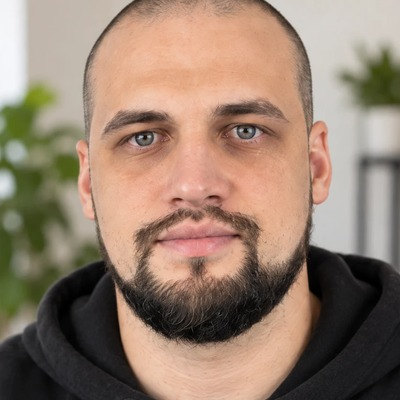

# PLAYBOOK — монтаж Reels «премиум моушн» для Traffic PRO (полностью самодостаточный)

Этот файл содержит **всё**, чтобы с нуля, без доступа к старым репозиториям и папкам, получить ролики того же качества:
пошаговую установку, все исходники (в приложениях, их нужно сохранить в файлы как есть), дизайн-систему, правила субтитров,
композиции, камеры и звука, приёмы анимации, чек-лист качества и список всех правок, которые заказчик делал раньше.

Проверено: из этих файлов заново собран ролик «Богатые клиенты» — он совпал с оригиналом почти попиксельно (средняя разница < 1/255), громкость −14 LUFS.

---

## 0. Как начать новый чат

1. Прикрепи к первому сообщению: **этот файл**, **видео** (вертикальное 9:16, лучше 1080×1920), при необходимости — **портрет** (для карточек «Меня зовут…»/Direct), **креативы** клиентов (картинки), **записи сайтов** (видео), **цифры кейсов**.
2. Вставь промпт:

```
Ты — монтажёр-моушн-дизайнер. Работай строго по прикреплённому PLAYBOOK.md:
сначала разверни окружение и проект из раздела «1. Установка» и приложений (сохрани каждый файл из приложений
дословно), скачай шрифты, звуки и музыку (раздел 2), затем смонтируй моё видео по разделам 3–9.
Перед полным рендером проверь контрольные стоп-кадры (субтитры не на лице, ничего не вылезает за края),
после рендера — лист кадров готового mp4. В отчёте перечисли, что сделано на каждом отрезке, какие цифры
иллюстративные, громкость и таймкоды «послушать в наушниках».
Мои решения по этому видео: <тайминги визуализаций, цифры, пожелания>
```

3. Типовые «решения», которые я обычно даю (можно копировать):
   - «С первых секунд моушн и визуализация над головой.»
   - «Чередуй мои кадры (с визуализацией над головой) с полноэкранными визуализациями под мой голос.»
   - «С X по Y секунду — визуализация под то, что я говорю / результаты клиентов / показ сайтов.»
   - «Сделай украинскую версию — всё на украинском» (присылаю второе видео с той же речью на украинском).

---

## 1. Установка с нуля (Linux / macOS)

```bash
# системное
#   ffmpeg, python3 (3.10+), node (18+), git, шрифт Noto Color Emoji (для эмодзи в графике)
sudo apt-get install -y ffmpeg fonts-noto-color-emoji git    # Debian/Ubuntu; на macOS: brew install ffmpeg node git

# python
pip install faster-whisper opencv-python-headless numpy librosa soundfile scipy pillow

# проект
mkdir -p reels && cd reels
npm init -y >/dev/null && npm i playwright && npx playwright install chromium
mkdir -p assets/fonts assets/creo work out
# Файлы из ПРИЛОЖЕНИЙ (раздел 14) извлекаются автоматически — положи PLAYBOOK.md в reels/ и выполни:
python3 - <<'PY'
import re
s=open('PLAYBOOK.md',encoding='utf-8').read()
for name,body in re.findall(r"### 14\.\d+ `([^`]+)`.*?\n````\w*\n(.*?)\n````",s,re.S):
    open(name,'w',encoding='utf-8').write(body+'\n'); print('saved',name)
PY
```

Примечания:
- `faster-whisper` с новыми версиями `av` падает на `metadata_errors` — поэтому `transcribe.py` подаёт аудио массивом через ffmpeg (уже учтено).
- Если Chromium уже установлен в системе и `npx playwright install` недоступен — Playwright сам найдёт браузер; при ошибке укажи `executablePath`.
- Модель whisper `large-v3` скачивается автоматически (~3 ГБ) при первом запуске; на CPU 1 минута видео ≈ 2–4 минуты.

---

## 2. Ассеты (скачать)

### 2.1 Шрифты (Google Fonts, лицензия OFL) → `assets/fonts/`
```bash
cd assets/fonts
curl -sSL -o oswald-cyr.woff2 https://fonts.gstatic.com/s/oswald/v57/TK3IWkUHHAIjg75cFRf3bXL8LICs1_Fv40pKlN4NNSeSASz7FmlSHYjedg.woff2
curl -sSL -o oswald-lat.woff2 https://fonts.gstatic.com/s/oswald/v57/TK3IWkUHHAIjg75cFRf3bXL8LICs1_Fv40pKlN4NNSeSASz7FmlWHYg.woff2
curl -sSL -o mont-cyr.woff2   https://fonts.gstatic.com/s/montserrat/v31/JTUSjIg1_i6t8kCHKm459W1hyzbi.woff2
curl -sSL -o mont-lat.woff2   https://fonts.gstatic.com/s/montserrat/v31/JTUSjIg1_i6t8kCHKm459Wlhyw.woff2
cd ../..
```
Если ссылки устарели: открой `https://fonts.googleapis.com/css2?family=Oswald:wght@600` и `…family=Montserrat:wght@500;600;700;800` с браузерным User-Agent и возьми woff2 для блоков `/* cyrillic */` и `/* latin */`. Oswald — переменный шрифт (одного файла хватает на все веса), Montserrat — тоже.

### 2.2 Звуковые эффекты (CC0) — библиотека скилла Barty-Bart
```bash
git clone --depth 1 https://github.com/Barty-Bart/motion-graphics ../motion-graphics
SFX=../motion-graphics/skills/sound-effects/sfx      # путь к библиотеке; внутри manifest.json с источниками и лицензиями
```
Скилл `skills/sound-effects` (README/SKILL.md) — методика звука: только реальные записанные звуки, один звук на событие, свипы чуть раньше события, громкость −14…−16 LUFS, проверка true peak, отчёт с таймкодами. Скилл `skills/motion-broll` — референс подхода «каждое изменение на слове». Сам их код не нужен — всё делают наши скрипты.

Если GitHub недоступен — список всех использованных файлов с первоисточниками (все CC0) в разделе 13; скачай их и разложи по тем же подпапкам (`whoosh/`, `pop/`, …), сконвертируй в `.ogg` (`ffmpeg -i in.wav -c:a libvorbis -q:a 4 out.ogg`), нормализуй пик к −3 dBFS.

### 2.3 Музыка
```bash
curl -sSL -o music.mp3 https://assets.mixkit.co/music/132/132.mp3   # «Hazy After Hours», Alejandro Magaña (A. M.), Mixkit #132
```
Лицензия Mixkit Stock Music Free License (YouTube/Instagram/TikTok — можно; Content ID — нельзя; файл не распространять отдельно).

### 2.4 Свои файлы
- Портрет для карточек → `assets/vadim.jpg` (квадрат по лицу):
  `ffmpeg -i portrait.jpg -vf "crop='min(iw,ih)*0.66':'min(iw,ih)*0.66':iw*0.49-ow/2:ih*0.40-oh/2,scale=400:400" assets/vadim.jpg`
- Креативы → `assets/creo/*.jpg` (уменьшить до высоты 1000: `ffmpeg -i in.png -vf scale=-2:1000 -q:v 3 out.jpg`). Узнай пропорции (`w/h`) — нужны для рамки телефона без обрезки.
- Записи сайтов → кадры: `mkdir -p site_frames/1_name && ffmpeg -i 1_name.mp4 -vf "fps=25,scale=840:-1:flags=lanczos" -q:v 3 site_frames/1_name/f_%04d.jpg` (первые ~11 кадров — белый экран загрузки, их пропускать).

---

## 3. Пайплайн одного ролика

```bash
V=work/main.mp4            # исходник
# 3.1 Разбор
ffprobe -v error -show_entries format=duration:stream=width,height,r_frame_rate -of csv=p=0 $V
ffmpeg -i $V -vf "select='gt(scene,0.08)',showinfo" -f null - 2>&1 | grep -o "pts_time:[0-9.]*"        # склейки (смена планов)
ffmpeg -v error -y -i $V -vf "fps=1,scale=144:-1,drawtext=text='%{n}':x=5:y=5:fontsize=24:fontcolor=yellow:box=1:boxcolor=black,tile=10x7" -frames:v 1 work/sheet.png
python3 transcribe.py $V work/words.json large-v3 ru      # ru | uk | en
python3 -c "import json;[print(' '.join(f\"{w['w'].strip()}[{w['s']:.2f}]\" for w in s['words'])) for s in json.load(open('work/words.json'))['segments']]"

# 3.2 Сцена: scene.html = scene_head.html + твоё тело (см. раздел 7; пример — example_scene_body.js)
cat scene_head.html my_body.js > scene.html

# 3.3 Контрольные стоп-кадры графики поверх видео (обязательно смотреть глазами)
node render_overlay.js work/chk times 1.0 3.5 6.2 9.0 12.4 ...
python3 check_sheet.py $V work/chk work/chk_sheet.png 7

# 3.4 Полный рендер графики (N = round(длительность*25)), 4 параллельных воркера
N=$(python3 -c "import subprocess;print(round(float(subprocess.check_output(['ffprobe','-v','error','-show_entries','format=duration','-of','csv=p=0','$V']))*25))")
Q=$((N/4)); for r in "0 $Q" "$Q $((2*Q))" "$((2*Q)) $((3*Q))" "$((3*Q)) $N"; do node render_overlay.js work/ovl 25 $r & done; wait

# 3.5 Камера + наложение, звук, сведение
python3 composite.py $V work/ovl work/video_noaudio.mp4 work/profile.json
python3 mix.py $V $SFX music.mp3 work/mix.wav work/profile.json
bash mux.sh work/video_noaudio.mp4 work/mix.wav out/reels_<name>_RU.mp4

# 3.6 Финальная проверка
ffmpeg -v error -y -i out/reels_<name>_RU.mp4 -vf "fps=1,scale=144:-1,tile=10x7" -frames:v 1 work/final_sheet.png
```
Точечная правка: перерендерь только кадры отрезка (`node render_overlay.js work/ovl 25 <from> <to>`), затем `composite.py` + `mux.sh` (микс не трогать, если звук тот же). Если субтитры — тоже только эти кадры.

`SCENE=<file>.html node render_overlay.js …` — рендер другой сцены; `LANG_CUT=uk` добавляет `?lang=uk` к адресу сцены.

---

## 4. Дизайн-система

**Цвета**
| Токен | Значение | Где |
|---|---|---|
| Акцент (янтарь) | `#FFB21E` | ключевые слова, кнопки, линии, галочки |
| Золотой текст | градиент `#FFD36A → #FFB21E → #FF8A1A` + `drop-shadow(0 0 18px rgba(255,170,40,.45))` | крупные суммы ($1 000 000, $50, $5 000) |
| Фон полноэкранных сцен `.v3bg` | `#0f1013` + точки `#2c2d33` шаг 30px + свечение сверху `rgba(255,178,30,.13)` | все full-screen сцены |
| Карточка `.glass` | `rgba(28,29,34,.94)`, бордер `rgba(255,255,255,.08)`, радиус 22–28, тень `0 24px 60px rgba(0,0,0,.5)` | на тёмном фоне |
| Карточка `.frost` | `rgba(18,18,22,.64)` + `backdrop-filter: blur(16px)`, бордер `rgba(255,255,255,.14)` | поверх видео (формы, Direct) |
| «Небо» `skyGlass` | `rgba(18,20,26,.46)`, бордер `rgba(255,255,255,.28)`, blur 14 | лёгкая графика над головой |
| Успех | `#2ecc71` / текст `#3ddc84` | ✓, «Продано», прибыль |
| Ошибка | `#ff4d4d` | ✕, перечёркивания плохого, падение |
| Вторичный текст | `#8e8f97`, `#9a9ba3`, `#c9cad2` | подписи |
| Instagram | кнопка `#0095f6`, отправка `#3797f0`, пузырь DM `linear-gradient(135deg,#7b3fe4,#d62976)`, кольцо сторис conic `#feda75,#fa7e1e,#d62976,#962fbf,#4f5bd5` | Direct, профиль |

**Шрифты**: Oswald 600 UPPERCASE — крупные слова субтитров (78px) и заголовки сцен (58–66px); Montserrat 600 32px lowercase — мелкие слова; Montserrat 700–800 14–30px — UI. Эмодзи — `'Noto Color Emoji'`.

**Размеры**: сцена верстается в 720×1280 CSS-пикселей, рендерится ×1.5 = 1080×1920. Поля по краям ≥ 40px.

**Иконки**: набор линейных SVG (обводка 7, янтарь) в `IC` (`ic(name,size)`): img, tag, sliders, page, home, hanger, tools, mask, browser, ig, check, users, user, chart, cal, list, deal, grid; в `ICON` (`svgIcon`): g, ig, mail. Добавлять новые в том же стиле.

**Плейсхолдеры**: квартиры/объекты — `photo(par,x,y,w,h,k)` (градиент + силуэт города, k=0..2); люди — `avatar(par,x,y,'А',i,size)`; мобильный сайт — нарисованный шаблон (шапка с бургером, первый экран, кнопка, карточки, форма), **не запись десктоп-сайта в телефоне**.

Тон: премиально, тёмный UI, один акцент — янтарь, без лишних цветов, без «дешёвых» эффектов (неон, радуги, резиновые отскоки).

---

## 5. Субтитры (кинетика)

- Карточка = 1–3 строки. Типы строк: `s` — мелкая белая (Montserrat), `b` — крупная белая (Oswald), `r` — крупная янтарная (акцент). Опционально `'strike', t` — янтарное перечёркивание крупного слова в момент t (для «шаблону», «картинку», «с потолка», «цифры»).
- Каждое слово появляется **в момент произнесения** (тайминг из whisper): pop 0.15 с — масштаб 0.55→1 с лёгким перелётом, blur 5→0.
- Данные: `[t_start, t_end, [['s',[['слово',t],…]], ['b',[…]], ['r',[…]]]]`; если у слова нет времени — `['слово']` (берётся предыдущее +0.1).
- Карточки идут **встык** (t_end одной = t_start следующей), смена — на начале новой мысли/слова.
- Акцент `r` — одно-два ключевых слова на фразу: цифры, итог, «система», «результат», название бренда, болевое слово.
- **Ширина**: строка `b`/`r` ≤ ~620px (≈12–14 знаков Oswald 78px). Длинное слово (украинские длинные!) — переносить в `s` или делить на 2 карточки.
- **Высота `SUB_Y(t)`** (доля высоты кадра, центр блока): задаётся **по каждому плану**:
  - кадры с лицом — на груди, **никогда на лице и подбородке**. Ориентиры: голова маленькая/далеко — 0.46–0.58; стоя у моря среднего плана — 0.56–0.62; сидя близко — 0.66–0.72;
  - полноэкранные сцены — 0.865–0.87;
  - если графика внизу кадра — субтитры между лицом и графикой.
- Исправлять ошибки распознавания вручную (пример: «отсудим» → «обсудим», «СЕО» → «SEO», брендовые названия).
- Последнее «оборванное» слово в конце видео не показывать.

---

## 6. Композиция, переходы, камера

### 6.1 Структура ролика (текущий формат)
- **С первой секунды** — лёгкая полупрозрачная графика «в небе» над головой (чипы/карточки `skyGlass`, лёгкое покачивание, уход вверх с фейдом), по словам.
- **Чередование**: кадры с лицом + графика над головой ↔ **полноэкранные сцены** под голос. Список `FULL=[[a,b],…]`; на этих интервалах оверлеи над головой скрыты, субтитры внизу.
- Полноэкранная сцена 3–7 с; лицо между ними ≥ 1 с (часто 3–7 с с оверлеем). Склейки исходника прятать внутрь полноэкранных сцен (переход в сцену чуть раньше склейки, выход — на склейке).
- Где голова высоко (стоя близко) — графика **внизу** кадра (над джинсами), не сверху.
- Финал (на «пишите/оставляйте заявку») — CTA: форма заявки (поля имя/телефон печатаются, тап, кнопка → зелёная «✓ Заявка отправлена») или Direct-переписка (портрет в кольце сторис, ник `zaslavskuy`, отправленное сообщение, ответ).
- Старый формат (если попросят): большие отрезки «по таймингам заказчика» — витрины сайтов, кейсы, схемы на весь экран, остальное — лицо с графикой над головой.

### 6.2 Переходы
- **В сцену**: `expandScene` (раскрытие карточкой из центра, clip-path inset + скругление 40→10px, 0.34 с) или `slideScene` (выезд снизу со скруглением верха). Чередовать.
- **К лицу**: zoom-blur «whip» в `composite.py` (`whips`: 0.26 с, 8 слоёв радиального размытия, доп. зум 1.30→1). Ставить на конец каждой полноэкранной сцены.
- **Фазы внутри сцены**: `phaseVis` — вход сдвигом 260px + blur 6px, выход в противоположную сторону.

### 6.3 Камера (`profile.json` → `anchors`, `cam`, `whips`)
- `anchors`: положение лица на каждом плане (x,y в долях кадра), например `{"A":[0.5,0.42],"B":[0.5,0.30]}`.
- `cam`: `[t0,t1,s0,s1,"A"]` — внутри отрезка плавный наезд s0→s1. Обычный: 1.00→1.04/1.06. **Панч-ин** на новой мысли/ключевом слове: резко 1.12–1.22 → чуть дальше.
- Источник всегда приводится к 25 fps (30 fps исходники — норм). Цвет: `eq=contrast=1.04:saturation=1.08`.

### 6.4 Анимация
- Изинги: `eOut` (cubic out), `eInOut`, `eBack` (лёгкий перелёт). Без «резиновых» отскоков.
- **Каждое изменение — на слово.** Счётчики цифр бегут 0.5–1.0 с от слова (цена — от большего к точному: `v*(3-2q)`).
- Тап: полупрозрачный круг, нажатие scale .78, ripple-волна из центра кнопки, кнопка меняет цвет/текст.
- Приёмы: перечёркивание неверного, красный ✕-бейдж, зелёная ✓, «глитч» (RGB-сдвиг тенью) для секретного, цензура-плашка, штамп («СЕКРЕТНО», «БЕЗ НАЗВАНИЯ»), прогресс-бары, кольцо ROAS (stroke-dashoffset), канбан Показ→Переговоры→Сделка, календарь показов, путь клиента со светящейся точкой, воронка, «шкала доверия», замок 🔒→🔓, тумблер кампании, «ИИ печатает текст».
- Креативы клиентов — **целиком**, в рамке телефона под их пропорцию (`phone(par,x,y,w,h,src,aspect)`), веером (−9°/0/+9°).
- Сайты — окна браузера с живыми кадрами записи (`setImg` + кадры 25 fps), каскадом с перекрытием; при необходимости перестройка в сетку 2×2.

### 6.5 Данные
- Реальные цифры — только из сообщения заказчика. Иллюстративные (имена, адреса, суммы-примеры) можно, но **всегда перечислить их в отчёте**.

---

## 7. Как устроена сцена (scene.html)

`scene_head.html` (приложение) содержит: шрифты, CSS-классы, хелперы (`clamp, lin, eOut, eInOut, eBack, mix, el, svgEl, kf, pop, applyPop, typed, fmtInt, remap`), контейнеры (`mkScene(id,'v3bg')` — полноэкранная сцена, `mkOv(id)` — слой поверх видео), иконки, `photo`, `avatar`, `phaseVis`, `slideScene`, `expandScene`, компоненты (`skyGlass, floatOut, skyChip, head, A_, glassBox, vis, xBadge, phone`). Затем идёт **тело ролика**:

1. `FULL`, `isFull`, `SUB_Y(t)` и массив `CARDS` + движок субтитров (`renderSubs`) — скопировать из примера.
2. `OV` — все оверлеи над головой: строятся один раз (IIFE), в `renderOV(t)` каждый показывается функцией `show(e, a, b, transform, from, i)` (pop-вход в a, уход вверх перед b).
3. Полноэкранные сцены `F1…Fn`: строятся один раз, `renderFn(t)` начинается с `if(!vis(S,t,a,b,'slide'|undefined))return;` и дальше всё по таймингам слов.
4. В конце:
```js
window.renderAt=function(t){pending.length=0;document.querySelectorAll('img').forEach(im=>{if(im.src)pending.push(im.decode().catch(()=>{}))});
 renderSubs(t);renderOV(t);renderF1(t);/*…*/return Promise.all(pending)};
window.renderAt(0);
</script></body></html>
```
Правила: всё абсолютное позиционирование в координатах 720×1280; рендер должен быть **детерминированным** от t (никаких таймеров/рандома без seed); если элемент собран через `display:flex`, при показе ставить `'flex'`, а не `'block'` (иначе ломается раскладка); тексты с эмодзи — шрифт `Mont,'Noto Color Emoji'`.

---

## 8. Звук (`profile.json` → `cues`, `cuts`, `music_db`, `sfx_db`)

- Голос: `highpass 75 Hz`, компрессор `-22 dB / 3:1 / 8 ms / 120 ms / +4 dB`, `loudnorm -16 LUFS`.
- SFX: один звук на событие. Кью: `[t, "папка/файл.ogg", gain_dB, "peak"|"onset", "описание", (обрезка_с)]`.

| Событие | Файл | Уровень | Выравнивание |
|---|---|---|---|
| вход в полноэкранную сцену | `kit/whoosh.ogg` | −6/−7 | peak, ~0.05 с после старта сцены |
| возврат к лицу (whip) | `whoosh/fs830856.ogg`, `whoosh/fs810485.ogg` | −6 | peak на старте whip (+0.02) |
| панч-ин / склейка | `whoosh/fs393811.ogg` | −16/−17 | peak |
| смена фазы/карточки | `transition/fs-786514-swoosh-v2.ogg`, `fs-683096-woosh`, `fs-816262-broomstick…`, `fs-850347-swipe-various` | −10…−13 | peak |
| появление элемента | `pop/kenney-interface-drop-00{1,2,3}.ogg`, `pluck-00{1,2}`, `pop/fs-447910-plop`, `fs527522`, `fs-824189-pop-in-sfx`, `fs202230` | −11…−14 | onset |
| галочка / пункт | `click/kenney-interface-select-00{1,2,3}.ogg` | −11…−13 | onset |
| успех / уведомление | `ding/kenney-interface-confirmation-00{1,2}.ogg`, `ding/kenney-interface-glass-00{1,2}.ogg` | −12/−13 | onset |
| акцент-удар | `impact/kenney-impact-impactsoft-heavy-00{0,1}.ogg` | −11…−13 | onset |
| крупный удар (итог, большая цифра) | `impact/fs-177242-cinematic-impact.ogg`, `kit/impact.ogg`, `impact/fs-222517-dramatic-hit.ogg` (штамп) | −10…−12 | onset |
| ошибка / ✕ / «нюанс» | `glitch/kenney-interface-glitch-002.ogg` | −13…−15 | onset |
| счётчик цифр | `typing/fs-511418-data-reveal-sound.ogg` | −14…−16 | onset (обрезка 0.6–1.2) |
| набор текста | `typing/fs-323432-typing.ogg`, `typing/fs-447909-keyboard-typing.ogg` | −16 | onset + обрезка по длине набора |
| тап по кнопке | `click/fs788933.ogg` | −8…−10 | onset |
| тумблер / замок | `click/kenney-interface-toggle-001.ogg` | −9 | onset |
| перечёркивание | `transition/fs-702773-swipe-wav.ogg` | −11/−12 | peak |
| «разряд / падение» | `riser/fs-174363-rewind.ogg` | −16 | onset, обрезка ~1.2 |
| путь / рост / «магия» | `riser/fs-685256-riser-sound-effect-short-wav.ogg`, `riser/kenney-digital-powerup1/2`, `phaserup1` | −16…−18 | onset |
| тихие чипы «в небе» | `ui-blip/kenney-ui-rollover1..4.ogg`, `kenney-digital-twotone1` | −15/−16 | onset |
| тайна / секрет | `transition/fs-856168-cyberpunk-glitch-hologram-tran.ogg`, `pop/fs-258269-mouth-pop.ogg` (🤫) | −11/−12 | onset |
| часы | `tick/fs528561.ogg` | −13/−14 | onset |

- Музыка: Mixkit #132, `music_db: -9`, дакинг под голос 45%, фейд-ин 50 мс, фейд-аут 1.2 с. Старт трека подбирается автоматически так, чтобы `cuts` (входы в сцены, возвраты к лицу, CTA) попадали в бит; ошибки в мс — в `*_report.json`.
- `sfx_db: +4` — стандарт (заказчик попросил эффекты и музыку громче; −9/+4 — согласованные значения).
- Мастер (`mux.sh`): −14 LUFS integrated, true peak −2 dBTP, AAC 256k 48 kHz; проверка stereo и mono.
- В отчёте: LUFS/peak, ошибки бит-грида, 4–5 таймкодов «послушать в наушниках». Не утверждать «звучит хорошо» — только измерения.

---

## 9. Языковые версии (украинская и др.)

Заказчик присылает второе видео с той же речью на другом языке (свои склейки и тайминги). Порядок:
1. `python3 transcribe.py uk.mp4 work/uk.json large-v3 uk`.
2. Скопируй сцену → `scene_uk.html`: замени все видимые строки (подписи, кнопки, заголовки, имена: «Александр»→«Олександр», «Оставить заявку»→«Залишити заявку», «✓ Заявка отправлена»→«✓ Заявку надіслано», «Имя»→«Ім'я»…). Апостроф внутри JS-строк в '…' — типографский `’`.
3. Новый `CARDS` по украинской речи и новый `SUB_Y` под склейки UK-видео.
4. Тайм-ремап: в `renderAt` каждую сцену вызывай как `renderF1(remap(t, TMU.f1))`, где `TMU.f1=[[t_uk, t_ru],…]` — пары одинаковых по смыслу слов (вход сцены, каждое ключевое слово, выход). Так вся анимация садится на украинскую речь без переписывания.
5. `profile_uk.json`: свои `anchors/cam/whips` по склейкам UK-видео; `cues` = русские кью со временем, пересчитанным через те же пары (`np.interp`), `cuts` — по UK.
6. Проверить ширину длинных украинских слов в крупных строках.

---

## 10. Чек-лист качества (все прошлые замечания заказчика)

- [ ] Субтитры **не перекрывают лицо** ни на одном плане (проверить каждый план после каждой склейки).
- [ ] Ни одно слово не выходит за рамки блока/кадра (широкое слово → `s` или перенос; блоки шире; «Предложение» в 208px не влезло — нужно 240px).
- [ ] Строки с иконкой+текстом в одну линию (`display:flex` не заменять на `block`).
- [ ] Креативы не обрезаны (рамка под пропорцию картинки); у Дубая было 2 креатива — веером, не ломая инфографику.
- [ ] Мобильные визуализации — мобильный шаблон, не десктоп-запись.
- [ ] Графика над головой не задевает макушку; графика «лёгкая» (полупрозрачная), когда просили ненавязчиво.
- [ ] Главный графический объект не перетягивает внимание (ракету в маятнике уменьшили вдвое).
- [ ] Полностью на нужном языке: цифры в нужной валюте (EN — доллары), все подписи переведены.
- [ ] Нет чужого бренда/шаблона один в один: цифры и подача свои (просили «не один в один как в шаблоне»).
- [ ] Свой бренд: Traffic PRO / trafficpro.online / @zaslavskuy; без визуализации Instagram-профиля, если не просят.
- [ ] 30 fps → 25; длинные видео (> 40 с) — камера в конце не «улетает».
- [ ] Последовательность: стоп-кадры → полный рендер → лист 1 fps готового mp4 → отчёт.

---

## 11. Бренд и данные

- Компания **Traffic PRO**, сайт **trafficpro.online**, Instagram **@zaslavskuy** (Vadym — Lead Generation Expert & Web Development, Одесса; география UA · USA · CA · UAE · EU · KZ). Опыт в рекламе и разработке сайтов с 2016 года.
- Кейсы (реальные, от заказчика):
  - Недвижимость, Дубай — 1 632 заявки · $32,51 за заявку · ROAS 575%
  - Оптовая продажа одежды, Италия — 3 228 · $7,20 · 961%
  - Сфера услуг / клининг (Украина) — 1 813 · $5,10 · 824%
  - Серая ниша — 2 357 · $4,83 · 1 617% (подавать таинственно: размытые «CLASSIFIED» креативы, глитч, цензура, 🤫, штамп)
  - Миллион долларов выручки клиенту за 3 месяца.
- Портфолио сайтов (записи): NACRE (аренда яхт, Дубай), ПІСЛЯ (клининг), OFFSET (архитектурное бюро), REALE SHOPPING TOUR (байеры, Италия).

---

## 12. Каталог сделанных роликов (идеи сцен для повторного использования)

| Ролик | Ключевые визуализации |
|---|---|
| «Боитесь заказать сайт» (RU/EN/UK) | карточка выручки клиента со счётчиком и графиком, карточки клиентов по нишам, LIVE + «новая оплата»; цепочка «маркетинг → продукт → трафик = результат»; телефон, в котором собирается сайт, чипы Instagram/Google Ads с потоком посетителей; ночные уведомления о заявках; форма заявки |
| «Портфолио» | 4 окна браузера с живыми записями сайтов каскадом; адаптив (десктоп → телефон), SEO (сайт поднимается на #1), дерево структуры, форма; «готов к рекламе», кампания с тумблером и счётчиком |
| «Реклама без клиентов» | «где теряются заявки» (4 карточки с ✕), рекламный кабинет с прожжённым бюджетом и «батарейкой желания», 4 кейса с кольцом ROAS и таинственной серой нишей, «вся связка» зигзагом |
| «Четыре ниши» | чипы в небе, 4 кейса подряд (креативы в телефонах + KPI), «система привлечения» из падающих блоков |
| «Сайт не за все деньги мира» | 💰 перечёркиваются; каскад сайтов → сетка 2×2 (ниша/задача/бюджет $–$$$); бриф → «нужно vs лишнее», смета сжимается; мобильный шаблон с плашками |
| «Система для агентства недвижимости» / «CRM для агентства» | кабинет риэлтора → автопубликация в каталог; поиск дублей (94%, опечатки, переименованная улица); ИИ пишет описание; панель руководителя (задачи, календарь показов, статус продаж); подбор альтернатив на встрече; ночной режим «из дома» |
| «Миллион за 3 месяца» | счётчик $1 000 000 в небе, «волшебная кнопка» → тап → запрет; «вся связка» кольцом вокруг «ВАШ БИЗНЕС»; 3 кейса с флагами; отчёт с лайками перечёркивается → «прибыль»; карточка «Вадим · Performance-маркетолог · с 2016» |
| «Сколько вкладывать в рекламу» | $500/$1 000/$5 000; ожидание vs реальность; формула CAC × продажи = бюджет; тесты A/B/C; пример $10 × 5 = $50; рост CAC и запас +20–30%; «сначала цифры → потом масштаб»; Direct |
| «Богатые клиенты» | таргет Rolex/яхты/Rolls-Royce; 48 интересуются → 3 платят; премиум-продукт; 4 проблемы внизу кадра; шкала доверия; 4 кирпича системы; путь клиента до покупки; чек-лист 🔒→🔓; Direct (полный код — пример в приложении) |
| Промо «Маятник» | см. приложение `scene_pendulum.html` и раздел 12.1 |

### 12.1 Промо «Маятник» (12 с, без голоса)
Референс: маятник, нить работает как шторка текста «НУЖЕН САЙТ?» ↔ «МЫ ПОМОЖЕМ.». Наша версия: тёмный стиль, вопросы НУЖЕН САЙТ? / НУЖНА РЕКЛАМА? / НУЖНЫ ЗАЯВКИ? / НУЖНА CRM? / НУЖНЫ КЛИЕНТЫ?, ответ золотым градиентом, груз — ракета (масштаб 0.57) с 3D-разворотом на 180° в крайних точках, пламя по скорости, шлейф и искры; подпись «САЙТЫ · РЕКЛАМА · ТЕХНОЛОГ**ИИ**» (ИИ приглушённым янтарём) + trafficpro.online. Тайминг 1:1 с референсом (синус, правая крайняя точка в t=0, 1.2 с на взмах) — звук берётся прямо из референса без сдвига.
```bash
SCENE=scene_pendulum.html node render_overlay.js work/pend 120 0 1459     # 120 fps
ffmpeg -y -framerate 120 -i work/pend/f_%05d.png -i reference.mp4 -map 0:v -map 1:a \
 -vf "format=rgb24,tmix=frames=3:weights='1 2 1',select='eq(mod(n\,4)\,1)',setpts=N/30/TB,format=yuv420p" -r 30 \
 -c:v libx264 -preset slow -crf 15 -af "loudnorm=I=-14:TP=-1.5:LRA=7" -c:a aac -b:a 256k -ar 48000 -t 12.14 -movflags +faststart out/pendulum.mp4
```

---

## 13. Использованные звуки и первоисточники (все CC0 1.0)

| Файл (в библиотеке `sfx/`) | Первоисточник |
|---|---|
| `click/fs788933.ogg` | https://freesound.org/people/Mediasaur/sounds/788933/ |
| `click/kenney-interface-select-001.ogg` | https://kenney.nl/assets/interface-sounds |
| `click/kenney-interface-select-002.ogg` | https://kenney.nl/assets/interface-sounds |
| `click/kenney-interface-select-003.ogg` | https://kenney.nl/assets/interface-sounds |
| `click/kenney-interface-toggle-001.ogg` | https://kenney.nl/assets/interface-sounds |
| `ding/fs-571513-soft-notifications-bell-ding-d.ogg` | https://freesound.org/people/LegitCheese/sounds/571513/ |
| `ding/fs-634690-lil-pip.ogg` | https://freesound.org/people/adh.dreaming/sounds/634690/ |
| `ding/kenney-interface-confirmation-001.ogg` | https://kenney.nl/assets/interface-sounds |
| `ding/kenney-interface-confirmation-002.ogg` | https://kenney.nl/assets/interface-sounds |
| `ding/kenney-interface-glass-001.ogg` | https://kenney.nl/assets/interface-sounds |
| `ding/kenney-interface-glass-002.ogg` | https://kenney.nl/assets/interface-sounds |
| `glitch/kenney-interface-glitch-002.ogg` | https://kenney.nl/assets/interface-sounds |
| `glitch/kenney-sci-computernoise-000.ogg` | https://kenney.nl/assets/sci-fi-sounds |
| `impact/fs-177242-cinematic-impact.ogg` | https://freesound.org/people/deleted_user_3277771/sounds/177242/ |
| `impact/fs-222517-dramatic-hit.ogg` | https://freesound.org/people/qubodup/sounds/222517/ |
| `impact/kenney-impact-impactsoft-heavy-000.ogg` | https://kenney.nl/assets/impact-sounds |
| `impact/kenney-impact-impactsoft-heavy-001.ogg` | https://kenney.nl/assets/impact-sounds |
| `kit/click.ogg` | https://freesound.org/people/adh.dreaming/sounds/671105/ |
| `kit/impact.ogg` | https://freesound.org/people/peoplearehappy/sounds/841274/ |
| `kit/pop.ogg` | https://freesound.org/people/ethernel0/sounds/776016/ |
| `kit/whoosh.ogg` | https://freesound.org/people/qubodup/sounds/60013/ |
| `pop/fs-258269-mouth-pop.ogg` | https://freesound.org/people/jcallison/sounds/258269/ |
| `pop/fs-447910-plop.ogg` | https://freesound.org/people/Breviceps/sounds/447910/ |
| `pop/fs-824189-pop-in-sfx.ogg` | https://freesound.org/people/Sadiquecat/sounds/824189/ |
| `pop/fs202230.ogg` | https://freesound.org/people/deraj/sounds/202230/ |
| `pop/fs527522.ogg` | https://freesound.org/people/Narjara/sounds/527522/ |
| `pop/kenney-interface-drop-001.ogg` | https://kenney.nl/assets/interface-sounds |
| `pop/kenney-interface-drop-002.ogg` | https://kenney.nl/assets/interface-sounds |
| `pop/kenney-interface-drop-003.ogg` | https://kenney.nl/assets/interface-sounds |
| `pop/kenney-interface-maximize-001.ogg` | https://kenney.nl/assets/interface-sounds |
| `pop/kenney-interface-maximize-002.ogg` | https://kenney.nl/assets/interface-sounds |
| `pop/kenney-interface-pluck-001.ogg` | https://kenney.nl/assets/interface-sounds |
| `pop/kenney-interface-pluck-002.ogg` | https://kenney.nl/assets/interface-sounds |
| `riser/fs-174363-rewind.ogg` | https://freesound.org/people/kasa90/sounds/174363/ |
| `riser/fs-685256-riser-sound-effect-short-wav.ogg` | https://freesound.org/people/syntheffects/sounds/685256/ |
| `riser/kenney-digital-phaserup1.ogg` | https://kenney.nl/assets/digital-audio |
| `riser/kenney-digital-powerup1.ogg` | https://kenney.nl/assets/digital-audio |
| `riser/kenney-digital-powerup2.ogg` | https://kenney.nl/assets/digital-audio |
| `tick/fs384187.ogg` | https://freesound.org/people/malle99/sounds/384187/ |
| `tick/fs528561.ogg` | https://freesound.org/people/Jummit/sounds/528561/ |
| `tick/fs721514.ogg` | https://freesound.org/people/BaggoNotes/sounds/721514/ |
| `transition/fs-683096-woosh.ogg` | https://freesound.org/people/florianreichelt/sounds/683096/ |
| `transition/fs-702773-swipe-wav.ogg` | https://freesound.org/people/LilMati/sounds/702773/ |
| `transition/fs-786514-swoosh-v2.ogg` | https://freesound.org/people/migoreng1/sounds/786514/ |
| `transition/fs-816262-broomstick-whoosh-3-quiet-okm1.ogg` | https://freesound.org/people/Sadiquecat/sounds/816262/ |
| `transition/fs-850347-swipe-various.ogg` | https://freesound.org/people/Gravy42/sounds/850347/ |
| `transition/fs-856168-cyberpunk-glitch-hologram-tran.ogg` | https://freesound.org/people/brktkrgll/sounds/856168/ |
| `typing/fs-323432-typing.ogg` | https://freesound.org/people/Alivvie/sounds/323432/ |
| `typing/fs-447909-keyboard-typing.ogg` | https://freesound.org/people/Breviceps/sounds/447909/ |
| `typing/fs-511418-data-reveal-sound.ogg` | https://freesound.org/people/Sky_Motion/sounds/511418/ |
| `ui-blip/kenney-digital-pepsound1.ogg` | https://kenney.nl/assets/digital-audio |
| `ui-blip/kenney-digital-twotone1.ogg` | https://kenney.nl/assets/digital-audio |
| `ui-blip/kenney-ui-rollover1.ogg` | https://kenney.nl/assets/ui-audio |
| `ui-blip/kenney-ui-rollover2.ogg` | https://kenney.nl/assets/ui-audio |
| `ui-blip/kenney-ui-rollover3.ogg` | https://kenney.nl/assets/ui-audio |
| `ui-blip/kenney-ui-rollover4.ogg` | https://kenney.nl/assets/ui-audio |
| `whoosh/fs-169867-swoosh.ogg` | https://freesound.org/people/Halgrimm/sounds/169867/ |
| `whoosh/fs-264777-swoosh.ogg` | https://freesound.org/people/Shinplaster/sounds/264777/ |
| `whoosh/fs-683101-quick-woosh.ogg` | https://freesound.org/people/florianreichelt/sounds/683101/ |
| `whoosh/fs393811.ogg` | https://freesound.org/people/deleted_user_6479820/sounds/393811/ |
| `whoosh/fs810485.ogg` | https://freesound.org/people/CVLTIV8R/sounds/810485/ |
| `whoosh/fs830856.ogg` | https://freesound.org/people/MeanRaccoon/sounds/830856/ |

---

## 14. Приложения — полный исходный код (сохранить дословно)

### 14.1 `transcribe.py`
````python
import sys, json
from faster_whisper import WhisperModel
m = WhisperModel(sys.argv[3] if len(sys.argv)>3 else "medium", device="cpu", compute_type="int8")
import subprocess, numpy as np
raw = subprocess.run(["ffmpeg","-v","error","-i",sys.argv[1],"-ac","1","-ar","16000","-f","s16le","-"],capture_output=True).stdout
audio = np.frombuffer(raw, np.int16).astype(np.float32)/32768
segs, info = m.transcribe(audio, word_timestamps=True, beam_size=5, language=(sys.argv[4] if len(sys.argv)>4 else None))
out = {"lang": info.language, "segments": []}
for s in segs:
    out["segments"].append({"start": s.start, "end": s.end, "text": s.text,
        "words": [{"w": w.word, "s": w.start, "e": w.end} for w in s.words]})
    print(f"[{s.start:.2f}-{s.end:.2f}] {s.text}", flush=True)
json.dump(out, open(sys.argv[2], "w"), ensure_ascii=False, indent=1)
````

### 14.2 `render_overlay.js`
````javascript
// Renders scene.html (or $SCENE) to transparent PNG frames. renderAt(t) may return a Promise (e.g. image frames loading).
// usage: node render_overlay.js <outDir> <fps> <startFrame> <endFrame(excl)>
//        node render_overlay.js <outDir> times 1.2 3.4 ...   (stills, named by time)
const { chromium } = require('playwright');
const path = require('path');
const fs = require('fs');

(async () => {
  const [outDir, mode, ...rest] = process.argv.slice(2);
  fs.mkdirSync(outDir, { recursive: true });
  const browser = await chromium.launch();
  const page = await browser.newPage({ viewport: { width: 720, height: 1280 }, deviceScaleFactor: 1.5 });
  await page.goto('file://' + path.resolve(__dirname, process.env.SCENE || 'scene.html') + (process.env.LANG_CUT ? '?lang=' + process.env.LANG_CUT : ''));
  await page.evaluate(() => document.fonts.ready);
  await page.evaluate(async () => { if (window.ready) await window.ready; });
  await page.waitForTimeout(300);
  const shoot = async (t, file) => {
    await page.evaluate(async (t) => { await window.renderAt(t); }, t);
    await page.screenshot({ path: file, omitBackground: true });
  };
  if (mode === 'times') {
    for (const t of rest.map(Number)) await shoot(t, path.join(outDir, `t_${t.toFixed(2)}.png`));
  } else {
    const fps = Number(mode), a = Number(rest[0]), b = Number(rest[1]);
    for (let i = a; i < b; i++) await shoot(i / fps, path.join(outDir, `f_${String(i).padStart(5, '0')}.png`));
  }
  await browser.close();
})();
````

### 14.3 `composite.py`
````python
"""Composite: source video -> 25 fps -> camera moves (push-ins / punch-ins) -> overlay PNG frames -> zoom-blur whips.
usage: python3 composite.py <source.mp4> <overlayDir> <out_noaudio.mp4> <profile.json>
profile.json:
  "anchors": {"A": [x, y], ...}          face position per shot, as fractions of the frame (0..1)
  "cam":     [[t0, t1, scale0, scale1, "A"], ...]   inside [t0,t1) the frame zooms scale0 -> scale1 around the anchor
  "whips":   [t, ...]                    zoom-blur transition starts (use the end of every full-screen scene)
"""
import sys, os, json, subprocess
import numpy as np, cv2

SRC, OVL, OUT, PROF = sys.argv[1:5]
W, H, FPS = 1080, 1920, 25
N = int(round(float(subprocess.check_output(
    ['ffprobe', '-v', 'error', '-show_entries', 'format=duration', '-of', 'csv=p=0', SRC])) * FPS))
P = json.load(open(PROF))
CAM = [(a, b, s0, s1, tuple(P['anchors'][k])) for a, b, s0, s1, k in P['cam']]
WHIPS = P.get('whips', [])
WHIP_LEN = 0.26


def cam_at(t):
    for t0, t1, s0, s1, a in CAM:
        if t0 <= t < t1:
            p = min(1.0, max(0.0, (t - t0) / max(1e-6, (min(t1, N / FPS) - t0))))
            p = p * p * (3 - 2 * p)
            return s0 + (s1 - s0) * p, a
    return 1.0, (0.5, 0.42)


def zoom(img, s, a):
    ax, ay = a[0] * W, a[1] * H
    M = np.float32([[s, 0, ax * (1 - s)], [0, s, ay * (1 - s)]])
    return cv2.warpAffine(img, M, (W, H), flags=cv2.INTER_LINEAR, borderMode=cv2.BORDER_REFLECT)


def whip(img, t):
    for w in WHIPS:
        if w <= t < w + WHIP_LEN:
            p = (t - w) / WHIP_LEN
            e = 1 - (1 - p) ** 3
            k = 1 + 0.30 * (1 - e)          # extra zoom that settles to 1
            spread = 0.10 * (1 - e)         # radial blur amount
            acc = np.zeros_like(img, dtype=np.float32)
            n = 8
            for i in range(n):
                acc += zoom(img, k * (1 + spread * i / (n - 1)), (0.5, 0.42)).astype(np.float32)
            return (acc / n).astype(np.uint8)
    return img


reader = subprocess.Popen(['ffmpeg', '-v', 'error', '-i', SRC, '-vf',
                           f'fps={FPS},scale={W}:{H}:flags=lanczos,eq=contrast=1.04:saturation=1.08',
                           '-f', 'rawvideo', '-pix_fmt', 'rgb24', '-'], stdout=subprocess.PIPE)
writer = subprocess.Popen(['ffmpeg', '-v', 'error', '-y', '-f', 'rawvideo', '-pix_fmt', 'rgb24', '-s', f'{W}x{H}',
                           '-r', str(FPS), '-i', '-', '-c:v', 'libx264', '-preset', 'medium', '-crf', '16',
                           '-pix_fmt', 'yuv420p', OUT], stdin=subprocess.PIPE)
i = 0
while True:
    buf = reader.stdout.read(W * H * 3)
    if len(buf) < W * H * 3:
        break
    t = i / FPS
    frame = np.frombuffer(buf, np.uint8).reshape(H, W, 3)
    s, a = cam_at(t)
    if s != 1.0:
        frame = zoom(frame, s, a)
    ov_path = os.path.join(OVL, f'f_{i:05d}.png')
    if os.path.exists(ov_path):
        ov = cv2.imread(ov_path, cv2.IMREAD_UNCHANGED)          # BGRA, or BGR when fully opaque
        rgb = ov[:, :, 2::-1]
        if ov.ndim == 3 and ov.shape[2] == 4:
            alpha = ov[:, :, 3:4].astype(np.float32) / 255.0
            frame = (frame.astype(np.float32) * (1 - alpha) + rgb.astype(np.float32) * alpha).astype(np.uint8)
        else:
            frame = rgb.copy()
    frame = whip(frame, t)
    writer.stdin.write(np.ascontiguousarray(frame).tobytes())
    i += 1
    if i % 100 == 0:
        print(f'{i}/{N}', flush=True)
writer.stdin.close(); writer.wait(); reader.wait()
print('frames', i)
````

### 14.4 `mix.py`
````python
"""Sound pass: voice + SFX cues (CC0 library from Barty-Bart/motion-graphics, skills/sound-effects/sfx) + ducked music bed.
usage: python3 mix.py <source.mp4> <sfxDir> <music.mp3> <out.wav> <profile.json>
profile.json:
  "cues":     [[t, "category/file.ogg", gain_dB, "peak"|"onset", "description", (optional trim seconds)], ...]
              peak  = the loudest point of the sound lands on t (whooshes, swipes)
              onset = the sound starts at t (pops, clicks, dings, impacts)
  "cuts":     [t, ...]   big visual changes; the music start is chosen so these land on beats
  "music_db": -9         music level vs voice (house standard: -9)
  "sfx_db":   4          extra SFX boost (house standard: +4)
Writes <out>_report.json (music offset, cut-to-beat error in ms, cue list).
"""
import sys, json, os, subprocess
import numpy as np, librosa

SRC, SFX, MUSIC, OUT, PROF = sys.argv[1:6]
SR = 48000


def load(path, mono=False):
    raw = subprocess.run(['ffmpeg', '-v', 'error', '-i', path, '-ac', '1' if mono else '2', '-ar', str(SR),
                          '-f', 'f32le', '-'], capture_output=True).stdout
    a = np.frombuffer(raw, np.float32)
    return a if mono else a.reshape(-1, 2)


def db(x): return 10 ** (x / 20)


voice = load(SRC)
N = len(voice)
dur = N / SR

PRO = json.load(open(PROF))
CUES = [tuple(c) for c in PRO['cues']]
CUTS = PRO['cuts']
MUSIC_DB = float(PRO.get('music_db', -9))
SFX_DB = float(PRO.get('sfx_db', 4))

sfx_bus = np.zeros((N, 2), np.float32)
report = []
for c in CUES:
    t, f, g, align, desc = c[:5]
    s = load(os.path.join(SFX, f))
    if len(c) > 5:                       # trim to length with a short fade
        L = int(c[5] * SR); s = s[:L].copy(); fl = min(len(s), int(.06 * SR)); s[-fl:] *= np.linspace(1, 0, fl)[:, None]
    off = int(np.argmax(np.abs(s).sum(1))) if align == 'peak' else 0
    start = int(t * SR) - off
    a, b = max(0, start), min(N, start + len(s))
    if b > a:
        sfx_bus[a:b] += s[a - start:b - start] * db(g)
    report.append({'t': t, 'file': f, 'gain_db': g, 'align': align, 'desc': desc})

# ---------- voice: high-pass + gentle compression via ffmpeg
vtmp = OUT + '.voice.wav'
subprocess.run(['ffmpeg', '-v', 'error', '-y', '-i', SRC, '-ac', '2', '-ar', str(SR), '-af',
                'highpass=f=75,acompressor=threshold=-22dB:ratio=3:attack=8:release=120:makeup=4dB,'
                'loudnorm=I=-16:TP=-3:LRA=7', vtmp], check=True)
voice = load(vtmp)[:N]
voice = np.pad(voice, ((0, N - len(voice)), (0, 0)))

# ---------- music: pick start offset so the big cuts land on beats
my, msr = librosa.load(MUSIC, sr=22050)
_, beats = librosa.beat.beat_track(y=my, sr=msr)
bt = librosa.frames_to_time(beats, sr=msr)
best = None
for off in np.arange(15.0, len(my) / msr - dur - 1, 0.01):    # skip the quiet intro
    rel = bt - off
    err = [np.min(np.abs(rel - c)) for c in CUTS]
    score = np.mean(err)
    if best is None or score < best[0]:
        best = (score, off, err)
_, moff, errs = best
music = load(MUSIC)
music = music[int(moff * SR):int(moff * SR) + N]
music = np.pad(music, ((0, N - len(music)), (0, 0)))
# music level ~ -12 dB under the voice, ducked further under speech
env = np.abs(voice).mean(1)
k = int(0.15 * SR)
env = np.convolve(env, np.ones(k) / k, mode='same')
speech = np.clip((20 * np.log10(env + 1e-6) + 45) / 15, 0, 1)        # 0 = silence, 1 = speaking
sm = int(0.12 * SR)
speech = np.convolve(speech, np.ones(sm) / sm, mode='same')
v_rms = np.sqrt(np.mean(voice ** 2)); m_rms = np.sqrt(np.mean(music ** 2))
music = music * (v_rms / m_rms) * db(MUSIC_DB) * (1 - 0.45 * speech)[:, None]
fade = int(1.2 * SR); music[-fade:] *= np.linspace(1, 0, fade)[:, None]
music[:int(.05 * SR)] *= np.linspace(0, 1, int(.05 * SR))[:, None]

mix = voice + sfx_bus * (v_rms / 0.1) * 0.9 * db(SFX_DB) + music
mix.astype(np.float32).tofile(OUT + '.raw')
subprocess.run(['ffmpeg', '-v', 'error', '-y', '-f', 'f32le', '-ar', str(SR), '-ac', '2', '-i', OUT + '.raw', OUT], check=True)
os.remove(OUT + '.raw'); os.remove(vtmp)
json.dump({'music_offset_s': round(float(moff), 2),
           'cut_to_beat_error_ms': {str(c): round(e * 1000) for c, e in zip(CUTS, errs)},
           'cues': report}, open(os.path.splitext(OUT)[0] + '_report.json', 'w'), ensure_ascii=False, indent=1)
print('music offset', round(float(moff), 2), 'beat errors ms', [round(e * 1000) for e in errs])
````

### 14.5 `mux.sh`
````bash
#!/usr/bin/env bash
# usage: mux.sh <video_noaudio.mp4> <mix.wav> <final.mp4>
# Two-pass loudnorm to -14 LUFS / -2 dBTP (reference video measures -14.3 LUFS).
set -euo pipefail
V=$1; A=$2; OUT=$3
J=$(ffmpeg -nostats -i "$A" -af loudnorm=I=-14:TP=-2:LRA=9:print_format=json -f null - 2>&1 | sed -n '/{/,/}/p')
MI=$(echo "$J" | python3 -c "import json,sys;d=json.load(sys.stdin);print(f\"measured_I={d['input_i']}:measured_TP={d['input_tp']}:measured_LRA={d['input_lra']}:measured_thresh={d['input_thresh']}:offset={d['target_offset']}\")")
ffmpeg -v error -y -i "$V" -i "$A" -af "loudnorm=I=-14:TP=-2:LRA=9:$MI:linear=true,aresample=48000" \
  -c:v copy -c:a aac -b:a 256k -shortest -movflags +faststart "$OUT"
echo "stereo:"; ffmpeg -nostats -i "$OUT" -af ebur128=peak=true -f null - 2>&1 | grep -E "^\s+(I|Peak):" | tail -2
echo "mono:";   ffmpeg -nostats -i "$OUT" -ac 1 -af ebur128=peak=true -f null - 2>&1 | grep -E "^\s+(I|Peak):" | tail -2
````

### 14.6 `check_sheet.py`
````python
"""Contact sheet of overlay stills composited over the source video frames.
usage: python3 check_sheet.py <source.mp4> <stillsDir> <out.png> [cols]
"""
import sys, glob, os, subprocess, io
from PIL import Image, ImageDraw

src, d, out = sys.argv[1:4]
cols = int(sys.argv[4]) if len(sys.argv) > 4 else 6
files = sorted(glob.glob(os.path.join(d, 't_*.png')), key=lambda f: float(os.path.basename(f)[2:-4]))
tw, th = 240, 427
sheet = Image.new('RGB', (cols * tw, ((len(files) + cols - 1) // cols) * th), 'black')
for i, f in enumerate(files):
    t = float(os.path.basename(f)[2:-4])
    raw = subprocess.run(['ffmpeg', '-v', 'error', '-ss', str(t), '-i', src, '-frames:v', '1',
                          '-vf', 'scale=1080:1920', '-f', 'image2pipe', '-vcodec', 'png', '-'], capture_output=True).stdout
    base = Image.open(io.BytesIO(raw)).convert('RGBA')
    ov = Image.open(f).convert('RGBA')
    base.alpha_composite(ov)
    im = base.convert('RGB').resize((tw, th), Image.LANCZOS)
    ImageDraw.Draw(im).text((4, 4), f'{t:.2f}', fill='yellow')
    sheet.paste(im, ((i % cols) * tw, (i // cols) * th))
sheet.save(out)
````

### 14.7 `scene_head.html` — шапка любой сцены (стили, хелперы, иконки, компоненты)
````html
<!doctype html>
<html><head><meta charset="utf-8">
<title>Reel overlay</title>
<style>
@font-face{font-family:Osw;src:url(assets/fonts/oswald-cyr.woff2) format('woff2');unicode-range:U+0400-045F,U+0490-0491,U+04B0-04B1,U+2116;font-weight:200 700}
@font-face{font-family:Osw;src:url(assets/fonts/oswald-lat.woff2) format('woff2');font-weight:200 700}
@font-face{font-family:Mont;src:url(assets/fonts/mont-cyr.woff2) format('woff2');unicode-range:U+0400-045F,U+0490-0491,U+04B0-04B1,U+2116;font-weight:100 900}
@font-face{font-family:Mont;src:url(assets/fonts/mont-lat.woff2) format('woff2');font-weight:100 900}
:root{--acc:#FFB21E;--green:#2ecc71}
html,body{margin:0;padding:0;background:transparent;overflow:hidden}
#root{position:relative;width:720px;height:1280px;overflow:hidden}
.scene{position:absolute;inset:0;overflow:hidden;display:none}
.abs{position:absolute}
.ov{position:absolute;left:0;top:0;width:720px;height:1280px;display:none}
/* subtitles */
#subs{position:absolute;inset:0;pointer-events:none}
.card{position:absolute;left:0;width:720px;display:none;flex-direction:column;align-items:center;transform:translateY(-50%)}
.line{display:flex;gap:.22em;justify-content:center;white-space:nowrap;position:relative}
.w{display:inline-block;transform-origin:50% 60%}
.ls{font:600 32px/1.1 Mont;color:#fff;text-shadow:0 2px 10px rgba(0,0,0,.65),0 0 3px rgba(0,0,0,.5)}
.lb,.lr{font:600 78px/0.98 Osw;text-transform:uppercase;letter-spacing:.5px;color:#fff;text-shadow:0 4px 16px rgba(0,0,0,.45),0 0 3px rgba(0,0,0,.35)}
.lr{color:var(--acc);text-shadow:0 0 2px rgba(0,0,0,.75),0 3px 6px rgba(0,0,0,.45),0 4px 22px rgba(0,0,0,.6)}
/* look */
.v3bg{background:radial-gradient(140% 38% at 50% 0%,rgba(255,178,30,.13) 0%,rgba(255,178,30,.05) 55%,rgba(255,178,30,0) 100%),radial-gradient(circle,#2c2d33 1.6px,transparent 2px) 0 0/30px 30px,#0f1013}
.glass{background:rgba(28,29,34,.94);border:1px solid rgba(255,255,255,.08);border-radius:26px;box-shadow:0 24px 60px rgba(0,0,0,.5)}
.frost{background:rgba(18,18,22,.64);border:1px solid rgba(255,255,255,.14);backdrop-filter:blur(16px);box-shadow:0 20px 60px rgba(0,0,0,.35)}
svg .wst{fill:none;stroke:#fff;stroke-linecap:round;stroke-linejoin:round}
/* browser window */
.win{position:absolute;width:560px;border-radius:16px;overflow:hidden;background:#141519;box-shadow:0 30px 70px rgba(0,0,0,.65),0 0 0 1px rgba(255,255,255,.07);transform-origin:50% 50%}
.win .bar{height:32px;display:flex;align-items:center;gap:7px;padding-left:14px;background:#1d1e23}
.win .dot{width:10px;height:10px;border-radius:50%}
.win .url{margin-left:14px;width:250px;height:18px;border-radius:9px;background:#2a2b31;position:relative}
.win .url:before{content:'';position:absolute;left:9px;top:5px;width:7px;height:8px;border-radius:2px;background:#6b6c74}
.win img{display:block;width:560px;height:421px;object-fit:cover}
.tag{position:absolute;padding:0 18px;height:46px;border-radius:23px;font:700 18px/46px Mont;color:#fff;white-space:nowrap;background:rgba(20,20,24,.9);border:1px solid rgba(255,178,30,.5);box-shadow:0 10px 30px rgba(0,0,0,.5)}
.tag b{color:var(--acc);margin-right:8px}
.pill{position:absolute;width:300px;height:58px;border-radius:29px;font:700 18px/58px Mont;color:#fff;white-space:nowrap;padding-left:62px;box-sizing:border-box}
.pill .ck{position:absolute;left:12px;top:11px;width:36px;height:36px;border-radius:50%;box-sizing:border-box;border:2px solid #4a4b52;color:#111;font:800 20px/32px Mont;text-align:center}
.inp{position:absolute;height:50px;border-radius:14px;background:rgba(255,255,255,.08);border:1px solid rgba(255,255,255,.14)}
.inp span{position:absolute;left:16px;top:15px;font:600 19px/1 Mont;color:#fff;white-space:pre}
.lbl{position:absolute;font:600 14px/1 Mont;color:#9a9ba3}
</style></head>
<body><div id="root"><div id="subs"></div></div>
<script>
// ================= helpers =================
const clamp=(x,a=0,b=1)=>Math.max(a,Math.min(b,x));
const lin=(t,a,b)=>clamp((t-a)/(b-a));
const eOut=p=>1-Math.pow(1-p,3);
const eInOut=p=>p<.5?4*p*p*p:1-Math.pow(-2*p+2,3)/2;
const eBack=p=>{const c=1.70158,c3=c+1;return 1+c3*Math.pow(p-1,3)+c*Math.pow(p-1,2)};
const mix=(a,b,p)=>a+(b-a)*p;
const $=id=>document.getElementById(id);
function el(tag,cls,parent,style){const e=document.createElement(tag);if(cls)e.className=cls;if(style)Object.assign(e.style,style);if(parent)parent.appendChild(e);return e}
function svgEl(tag,attrs,parent){const e=document.createElementNS('http://www.w3.org/2000/svg',tag);for(const k in attrs)e.setAttribute(k,attrs[k]);if(parent)parent.appendChild(e);return e}
function kf(t,keys,ease=eInOut){if(t<=keys[0][0])return keys[0][1];for(let i=1;i<keys.length;i++){if(t<=keys[i][0]){const[a,va]=keys[i-1],[b,vb]=keys[i];const p=ease((t-a)/(b-a));return Array.isArray(va)?va.map((v,j)=>mix(v,vb[j],p)):mix(va,vb,p)}}return keys[keys.length-1][1]}
function pop(t,at,dur=.16,from=.6){const p=lin(t,at,at+dur);return{o:t<at?0:clamp(p*2.2),s:from+(1-from)*eBack(p),b:(1-p)*5}}
function applyPop(e,t,at,extra='',dur,from){const q=pop(t,at,dur,from);e.style.opacity=q.o;e.style.transform=`${extra} scale(${q.s})`;e.style.filter=q.b>.05?`blur(${q.b}px)`:'none'}
const typed=(str,t,a,b)=>str.slice(0,Math.round(clamp((t-a)/(b-a))*str.length));
const fmtInt=v=>Math.round(v).toString().replace(/\B(?=(\d{3})+(?!\d))/g,' ');
const ACC='#FFB21E';
// piecewise-linear time remap (used for language cuts): pts=[[t_this_cut, t_master],...]
function remap(t,pts){if(t<=pts[0][0])return pts[0][1]+(t-pts[0][0]);for(let i=1;i<pts.length;i++){if(t<=pts[i][0]){const[a,ra]=pts[i-1],[b,rb]=pts[i];return ra+(t-a)/(b-a)*(rb-ra)}}const Z=pts[pts.length-1];return Z[1]+(t-Z[0])}
const RED='#ff4d4d';
const root=$('root');
function mkScene(id,cls){const s=el('div','scene '+(cls||''));s.id=id;root.insertBefore(s,$('subs'));return s}
function mkOv(id){const s=el('div','ov');s.id=id;root.insertBefore(s,$('subs'));return s}
const ICON={
 g:`<path fill="none" stroke="${ACC}" stroke-width="12" d="M80 30 A36 36 0 1 0 86 54 L52 54"/>`,
 ig:`<rect x="12" y="12" width="76" height="76" rx="22" fill="none" stroke="${ACC}" stroke-width="9"/><circle cx="50" cy="50" r="17" fill="none" stroke="${ACC}" stroke-width="9"/><circle cx="70" cy="30" r="5" fill="${ACC}"/>`,
 mail:'<path fill="none" stroke="#111" stroke-width="8" stroke-linejoin="round" d="M14 26 H86 V74 H14 Z M14 26 L50 54 L86 26"/>',
};
const svgIcon=(name,size)=>`<svg viewBox="0 0 100 100" width="${size}" height="${size}" style="overflow:visible;display:block">${ICON[name]}</svg>`;
// image swap that resolves once the new frame is decoded
const pending=[];
function setImg(img,src){if(img.dataset.src===src)return;img.dataset.src=src;img.src=src;pending.push(img.decode().catch(()=>{}))}

const IC={
 img:`<rect x="12" y="20" width="76" height="60" rx="10" fill="none" stroke="${ACC}" stroke-width="7"/><circle cx="34" cy="40" r="7" fill="${ACC}"/><path d="M16 74 L40 52 L56 66 L68 56 L86 74" fill="none" stroke="${ACC}" stroke-width="7" stroke-linejoin="round"/>`,
 tag:`<path d="M14 50 L50 14 H86 V50 L50 86 Z" fill="none" stroke="${ACC}" stroke-width="7" stroke-linejoin="round"/><circle cx="68" cy="32" r="7" fill="${ACC}"/>`,
 sliders:`<path d="M14 28 H86 M14 50 H86 M14 72 H86" stroke="${ACC}" stroke-width="7" stroke-linecap="round"/><circle cx="66" cy="28" r="9" fill="#17181c" stroke="${ACC}" stroke-width="6"/><circle cx="30" cy="50" r="9" fill="#17181c" stroke="${ACC}" stroke-width="6"/><circle cx="74" cy="72" r="9" fill="#17181c" stroke="${ACC}" stroke-width="6"/>`,
 page:`<rect x="30" y="12" width="56" height="72" rx="8" fill="none" stroke="${ACC}" stroke-width="7"/><path d="M42 32 H74 M42 46 H66" stroke="${ACC}" stroke-width="6" stroke-linecap="round"/><path d="M8 80 L28 60 M28 60 L14 60 M28 60 L28 74" fill="none" stroke="${ACC}" stroke-width="6" stroke-linecap="round"/>`,
 home:`<path d="M14 48 L50 18 L86 48 M24 42 V84 H76 V42" fill="none" stroke="${ACC}" stroke-width="7" stroke-linejoin="round" stroke-linecap="round"/><rect x="42" y="58" width="16" height="26" fill="${ACC}"/>`,
 hanger:`<path d="M50 30 Q50 18 60 20 Q68 24 60 32 L50 40 L12 70 Q8 76 16 76 H84 Q92 76 88 70 L50 40" fill="none" stroke="${ACC}" stroke-width="7" stroke-linejoin="round" stroke-linecap="round"/>`,
 tools:`<path d="M30 70 L62 38 M58 22 A16 16 0 0 0 78 42 L66 38 L62 34 Z" fill="none" stroke="${ACC}" stroke-width="7" stroke-linejoin="round" stroke-linecap="round"/><path d="M22 78 L30 70" stroke="${ACC}" stroke-width="12" stroke-linecap="round"/>`,
 mask:`<path d="M10 36 Q50 22 90 36 Q90 66 66 70 Q56 72 50 60 Q44 72 34 70 Q10 66 10 36 Z" fill="none" stroke="${ACC}" stroke-width="7" stroke-linejoin="round"/><ellipse cx="32" cy="46" rx="8" ry="5" fill="${ACC}"/><ellipse cx="68" cy="46" rx="8" ry="5" fill="${ACC}"/>`,
 browser:`<rect x="10" y="18" width="80" height="64" rx="10" fill="none" stroke="${ACC}" stroke-width="7"/><path d="M10 36 H90" stroke="${ACC}" stroke-width="7"/><circle cx="22" cy="27" r="3.5" fill="${ACC}"/><circle cx="33" cy="27" r="3.5" fill="${ACC}"/>`,
 ig:ICON.ig, check:`<path d="M22 52 L42 72 L80 30" fill="none" stroke="#111" stroke-width="11" stroke-linecap="round" stroke-linejoin="round"/>`,
};
const ic=(n,s)=>`<svg viewBox="0 0 100 100" width="${s}" height="${s}" style="overflow:visible;display:block">${IC[n]}</svg>`;
function slideScene(S,t,a){const sp=eOut(lin(t,a,a+.34));S.style.transform=sp<1?`translateY(${(1-sp)*100}%)`:'none';S.style.borderRadius=sp<1?'36px 36px 0 0':'0'}
function expandScene(S,t,a){const p=eOut(lin(t,a,a+.34));S.style.clipPath=p<1?`inset(${(1-p)*40}% ${(1-p)*26}% ${(1-p)*40}% ${(1-p)*26}% round ${10+30*(1-p)}px)`:'none'}

// ---------- extra icons ----------
Object.assign(IC,{
 users:`<circle cx="38" cy="34" r="13" fill="none" stroke="${ACC}" stroke-width="7"/><path d="M14 82 A24 24 0 0 1 62 82" fill="none" stroke="${ACC}" stroke-width="7" stroke-linecap="round"/><circle cx="70" cy="40" r="9" fill="none" stroke="${ACC}" stroke-width="6"/><path d="M62 62 A18 18 0 0 1 88 78" fill="none" stroke="${ACC}" stroke-width="6" stroke-linecap="round"/>`,
 user:`<circle cx="50" cy="34" r="16" fill="none" stroke="${ACC}" stroke-width="7"/><path d="M20 86 A30 30 0 0 1 80 86" fill="none" stroke="${ACC}" stroke-width="7" stroke-linecap="round"/>`,
 chart:`<path d="M14 84 H88" stroke="${ACC}" stroke-width="7" stroke-linecap="round"/><path d="M18 70 L40 48 L56 60 L84 24" fill="none" stroke="${ACC}" stroke-width="7" stroke-linecap="round" stroke-linejoin="round"/><path d="M68 24 H84 V40" fill="none" stroke="${ACC}" stroke-width="7" stroke-linecap="round" stroke-linejoin="round"/>`,
 cal:`<rect x="12" y="20" width="76" height="66" rx="12" fill="none" stroke="${ACC}" stroke-width="7"/><path d="M12 40 H88 M32 10 V28 M68 10 V28" stroke="${ACC}" stroke-width="7" stroke-linecap="round"/>`,
 list:`<path d="M34 28 H86 M34 50 H86 M34 72 H86" stroke="${ACC}" stroke-width="7" stroke-linecap="round"/><circle cx="16" cy="28" r="5" fill="${ACC}"/><circle cx="16" cy="50" r="5" fill="${ACC}"/><circle cx="16" cy="72" r="5" fill="${ACC}"/>`,
 deal:`<path d="M10 50 L30 30 L50 40 L70 30 L90 50 L62 78 Q56 84 50 78 L10 50 Z" fill="none" stroke="${ACC}" stroke-width="7" stroke-linejoin="round"/>`,
 grid:`<rect x="12" y="12" width="32" height="32" rx="6" fill="none" stroke="${ACC}" stroke-width="7"/><rect x="56" y="12" width="32" height="32" rx="6" fill="none" stroke="${ACC}" stroke-width="7"/><rect x="12" y="56" width="32" height="32" rx="6" fill="none" stroke="${ACC}" stroke-width="7"/><rect x="56" y="56" width="32" height="32" rx="6" fill="${ACC}"/>`,
});
const AVC=['#e67e22','#3498db','#9b59b6','#1abc9c','#e84393'];
const avatar=(par,x,y,ini,i,sz=40)=>{const a=el('div','abs',par,{left:x+'px',top:y+'px',width:sz+'px',height:sz+'px',borderRadius:'50%',background:AVC[i%5],color:'#fff',font:`800 ${Math.round(sz*.42)}px/${sz}px Mont`,textAlign:'center',border:'2.5px solid #1c1d22',boxSizing:'border-box'});a.textContent=ini;return a};
// stylised property photo
const PH=[['#f3c98b','#c97b4a','#5a3b2e'],['#9ec9e8','#4a7fa8','#24384d'],['#e9d9c4','#b59a7a','#4a4036']];
function photo(par,x,y,w,h,k){const p=el('div','abs',par,{left:x+'px',top:y+'px',width:w+'px',height:h+'px',borderRadius:'12px',overflow:'hidden',background:`linear-gradient(180deg,${PH[k][0]},${PH[k][1]})`});
 p.innerHTML=`<svg viewBox="0 0 100 70" preserveAspectRatio="none" width="100%" height="100%" style="position:absolute;left:0;top:0"><path d="M0 70 V40 H14 V22 H30 V34 H44 V12 H58 V30 H70 V20 H84 V38 H100 V70 Z" fill="${PH[k][2]}" opacity=".85"/>
  <g fill="rgba(255,220,150,.75)"><rect x="17" y="27" width="3" height="3"/><rect x="23" y="27" width="3" height="3"/><rect x="47" y="17" width="3" height="3"/><rect x="52" y="22" width="3" height="3"/><rect x="47" y="27" width="3" height="3"/><rect x="73" y="25" width="3" height="3"/><rect x="78" y="31" width="3" height="3"/></g></svg>`;return p}
function phaseVis(e,t,a,b,dist=260){const i=lin(t,a,a+.32),o=lin(t,b-.24,b);const on=t>=a&&t<b+.001;e.style.display=on?'block':'none';if(!on)return 0;
 e.style.opacity=clamp(i*2.5)*(1-o);e.style.filter=(1-i)+o>0.02?`blur(${((1-i)+o)*6}px)`:'none';return (1-eOut(i))*dist-eInOut(o)*dist}


// ================= common components =================
const EMO="'Noto Color Emoji',sans-serif";
const GRN='#3ddc84';
const skyGlass={background:'rgba(18,20,26,.46)',border:'1px solid rgba(255,255,255,.28)',backdropFilter:'blur(14px)',boxShadow:'0 14px 40px rgba(0,0,0,.18)'};
const floatOut=(e,t,out,i=0)=>{e.style.opacity=Math.min(1,parseFloat(e.style.opacity)||0)*(1-out);e.style.transform+=` translateY(${Math.sin(t*1.5+i)*3-out*40}px)`};
const skyChip=(par,y,html,extra)=>{const c=el('div','abs',par,Object.assign({left:'50%',top:y+'px',height:'60px',padding:'0 24px',borderRadius:'30px',color:'#fff',font:`800 22px/60px Mont,${EMO}`,whiteSpace:'nowrap'},skyGlass,extra||{}));c.innerHTML=html;return c};
const head=(par,html,top=110)=>{const h=el('div','abs',par,{left:'30px',top:top+'px',width:'660px',textAlign:'center',font:'600 58px/1.05 Osw',color:'#fff',textTransform:'uppercase'});h.innerHTML=html;return h};
const A_=s=>`<span style="color:${ACC}">${s}</span>`;
const glassBox=(par,x,y,w,h,extra)=>el('div','glass abs',par,Object.assign({left:x+'px',top:y+'px',width:w+'px',height:h+'px',borderRadius:'24px'},extra||{}));
function vis(S,t,a,b,mode){const on=t>=a&&t<b;S.style.display=on?'block':'none';if(!on)return false;(mode==='slide'?slideScene:expandScene)(S,t,a);return true}
const xBadge=(par,x,y)=>{const b=el('div','abs',par,{left:x+'px',top:y+'px',width:'40px',height:'40px',borderRadius:'50%',background:RED,color:'#fff',font:'800 22px/40px Mont',textAlign:'center',boxShadow:'0 6px 16px rgba(0,0,0,.4)'});b.textContent='✕';return b};

// device phone frame, sized to the image aspect (never crops a creative)
function phone(par,x,y,w,h,src,asp){if(asp){const hh=Math.round((w-12)/asp+12);y=y+(h-hh)/2;h=hh}
 const p=el('div','abs',par,{left:x+'px',top:y+'px',width:w+'px',height:h+'px',borderRadius:'26px',border:'6px solid #26272c',boxSizing:'border-box',overflow:'hidden',background:'#000',boxShadow:'0 26px 60px rgba(0,0,0,.6)',transformOrigin:'50% 50%'});
 if(src){const im=el('img','',p,{width:'100%',height:'100%',objectFit:asp?'contain':'cover',objectPosition:'50% 0%',display:'block'});im.src=src}return p}
````

### 14.8 `example_scene_body.js` — тело сцены-образца («Богатые клиенты», 59 с)
Собрать сцену: `cat scene_head.html example_scene_body.js > scene.html`. Используй как шаблон: субтитры, оверлеи над головой, полноэкранные сцены, Direct.
````javascript
// ---------- P11: "rich clients need more than ads" reel ----------
// ---------- SUBTITLES ----------
const FULL=[[5.90,11.75],[13.00,18.00],[25.56,30.00],[33.90,40.00],[42.70,47.04]];
const isFull=t=>FULL.some(([a,b])=>t>=a&&t<b);
const SUB_Y=t=>isFull(t)?0.87:t<6.4?0.58:t<25.56?0.585:t<40?0.66:t<47.04?0.62:0.72;
const CARDS=[
 [0.00,1.40,[['b',[['думаете,',0.00]]],['s',[['добавили',0.50],['в',1.00],['таргет',1.14]]]]],
 [1.40,2.50,[['r',[['rolex,',1.40],['яхты',1.92]]],['s',[['и',2.40]]]]],
 [2.50,3.56,[['r',[['rolls-royce',2.50]]],['s',[['и',2.96],['всё,',3.22]]]]],
 [3.56,4.94,[['s',[['получили',3.56]]],['b',[['богатых',4.00],['клиентов?',4.36]]]]],
 [4.94,6.34,[['b',[['ага,',4.94],['конечно',5.48]]]]],
 [6.34,7.86,[['b',[['интересоваться',6.34]]],['s',[['дорогими',6.98],['вещами',7.38]]]]],
 [7.86,9.56,[['s',[['и',7.86],['быть',8.14],['готовым',8.32],['за',8.86],['них']]],['r',[['платить',9.06]]]]],
 [9.56,11.96,[['s',[['это',9.56],['две',10.00],['совершенно',10.18]]],['b',[['разные',10.64],['истории',11.14]]]]],
 [11.96,13.42,[['b',[['представьте,',11.96]]],['s',[['у',12.62],['вас',12.90],['салон',13.06]]]]],
 [13.42,15.00,[['s',[['дорогой',13.42]]],['b',[['мебели',13.76]]],['s',[['качественные',14.20]]]]],
 [15.00,16.90,[['b',[['материалы',15.00]]],['s',[['отличная',15.72],['фурнитура',16.22]]]]],
 [16.90,18.12,[['s',[['идеальная',16.90]]],['r',[['сборка',17.48]]]]],
 [18.12,19.74,[['s',[['а',18.12],['в',18.58],['instagram',18.60]]],['b',[['фотографии',19.10]]],['s',[['на',19.66],['телефон',19.74]]]]],
 [19.74,21.72,[['b',[['сайт',20.30]]],['r',[['2000-х',20.66]]],['s',[['годов',21.20]]]]],
 [21.72,23.20,[['b',[['непонятные',21.72]]],['s',[['предложения',22.34],['и',23.00]]]]],
 [23.20,25.34,[['b',[['сообщения,',23.20]]],['s',[['на',23.80],['которые',23.92],['отвечают',24.12],['через',24.60]]],['r',[['сутки',24.78]]]]],
 [25.34,26.82,[['s',[['и',25.34],['вот',25.66]]],['b',[['вопрос',25.78]]],['s',[['почему',26.34]]]]],
 [26.82,28.26,[['s',[['клиент',26.82],['должен']]],['b',[['доверить',27.62]]],['s',[['вам',28.12]]]]],
 [28.26,30.00,[['s',[['несколько',28.26]]],['r',[['тысяч',28.68],['долларов?',29.12]]]]],
 [30.00,31.70,[['s',[['хотите',30.00],['привлекать',30.34],['клиентов',30.78],['с',31.18]]],['b',[['высоким',31.32],['чеком?',31.70]]]]],
 [31.70,34.08,[['s',[['тогда',32.08],['работайте',32.56]]],['b',[['не',33.00],['только',33.18]]],['s',[['над',33.40],['рекламой',33.60]]]]],
 [34.08,35.58,[['s',[['нужны',34.08],['сильная',34.56]]],['b',[['упаковка',34.96]]]]],
 [35.58,36.72,[['s',[['качественный',35.58]]],['b',[['контент',36.14]]]]],
 [36.72,38.12,[['s',[['понятное',36.72]]],['b',[['позиционирование',37.34]]]]],
 [38.12,39.82,[['s',[['и',38.12],['нормальная',38.26]]],['b',[['обработка',38.78]]],['s',[['заявок',39.32]]]]],
 [39.82,41.34,[['s',[['потому',39.82],['что',40.18]]],['b',[['реклама',40.42]]],['s',[['лишь',41.08]]]]],
 [41.34,43.38,[['b',[['приводит',41.34]]],['s',[['человека',41.90],['к',42.14],['вашему',42.40],['предложению',42.68]]]]],
 [43.38,45.08,[['s',[['а',43.38],['вот',43.72]]],['r',[['убедить',43.86]]],['s',[['его',44.32],['купить',44.50]]]]],
 [45.08,46.84,[['s',[['задача',45.08],['всей',45.64],['остальной',45.80]]],['b',[['системы',46.26]]]]],
 [46.84,48.98,[['s',[['поэтому,',46.84],['прежде',47.34],['чем',47.88],['увеличивать',48.04]]],['b',[['бюджет',48.98]]]]],
 [48.98,50.94,[['r',[['убедитесь,',49.40]]],['s',[['что',50.14],['ваш',50.38],['бизнес',50.60]]]]],
 [50.94,52.38,[['b',[['готов',50.94]]],['s',[['к',51.34],['этим',51.62],['клиентам',51.76]]]]],
 [52.38,54.10,[['s',[['а',52.38],['если',52.78],['не',52.96],['знаете,',53.10],['с',53.36],['чего']]],['b',[['начать',53.62]]]]],
 [54.10,55.30,[['b',[['напишите',54.10]]],['s',[['мне',54.60],['в',54.74]]],['r',[['direct',54.86]]]]],
 [55.30,56.78,[['b',[['разберём',55.30]]],['s',[['вашу',55.90],['ситуацию',56.12]]]]],
 [56.78,59.10,[['s',[['и',56.60],['обсудим,',56.78],['как',57.24],['привлечь',57.52]]],['b',[['больше',57.96],['клиентов',58.12]]]]],
];
const cardEls=[];
(function(){const R=$('subs');
 for(const c of CARDS){const ce=el('div','card',R);const words=[];
  for(const L of c[2]){if(typeof L!=='object')continue;const le=el('div','line l'+L[0],ce);let last=c[0];
   for(const [txt,at] of L[1]){const w=el('span','w',le);w.textContent=L[0]==='s'?txt.toLowerCase():txt.toUpperCase();const a=at===undefined?last+.1:at;last=a;words.push([w,a])}}
  cardEls.push({c,ce,words})}})();
function renderSubs(t){const y=SUB_Y(t)*1280;
 for(const k of cardEls){const on=t>=k.c[0]&&t<k.c[1];k.ce.style.display=on?'flex':'none';if(!on)continue;k.ce.style.top=y+'px';
  for(const [w,at] of k.words)applyPop(w,t,at,'',.15,.55)}}

// ================= FACE OVERLAYS =================
const OV={};
(function(){const S=mkOv('ov');OV.S=S;
 // A 0–5.9: targeting interests (head top ≈ 340px)
 OV.tg=el('div','abs',S,Object.assign({left:'60px',top:'40px',width:'600px',height:'150px',borderRadius:'26px'},skyGlass));
 OV.tg.innerHTML=`<div style="position:absolute;left:24px;top:18px;font:800 17px/1 Mont,${EMO};color:#fff">🎯 Таргетинг · интересы</div>`;
 OV.ti=['⌚ Rolex','🛥 Яхты','🚗 Rolls-Royce'].map((x,i)=>{const c=el('div','abs',OV.tg,{left:[20,192,350][i]+'px',top:'60px',height:'60px',padding:'0 18px',borderRadius:'30px',background:'rgba(255,178,30,.22)',border:`1px solid ${ACC}`,color:'#fff',font:`800 21px/58px Mont,${EMO}`,whiteSpace:'nowrap',boxSizing:'border-box'});c.textContent=x;return c});
 OV.rich=skyChip(S,206,`= 💎 Богатые клиенты?`);
 OV.richX=el('div','abs',OV.rich,{left:'14px',right:'14px',top:'27px',height:'6px',borderRadius:'3px',background:RED,transformOrigin:'0 50%',transform:'scaleX(0)'});
 OV.eye=el('div','abs',S,{left:'560px',top:'190px',font:`70px/1 ${EMO}`});OV.eye.textContent='🙄';
 // C1 11.75–13: salon chip (head top ≈ 230)
 OV.sal=skyChip(S,50,`🛋 Салон дорогой мебели`);
 // C2 18–25.56: 4 problem cards at the bottom
 OV.pc=[];const PC=[['📱','Фото на телефон',19.10],['🌐','Сайт из 2000-х',20.30],['❓','Непонятный оффер',21.72],['💬','Ответ через сутки',23.20]];
 PC.forEach(([ico,tt,at],i)=>{const x=40+(i%2)*326,y=846+Math.floor(i/2)*196;const c=el('div','frost abs',S,{left:x+'px',top:y+'px',width:'314px',height:'180px',borderRadius:'22px',overflow:'hidden'});
  let vis='';
  if(i===0)vis=`<div style="position:absolute;left:16px;top:56px;width:282px;height:104px;border-radius:12px;background:linear-gradient(135deg,#a58f78,#6d5a4a);filter:blur(6px)"></div><div style="position:absolute;left:30px;top:70px;width:120px;height:70px;border-radius:8px;background:#c9b49a;filter:blur(5px)"></div>`;
  if(i===1)vis=`<div style="position:absolute;left:16px;top:56px;width:282px;height:104px;border-radius:4px;background:linear-gradient(180deg,#0000aa,#5555ff 30%,#c0c0c0 30%);border:2px outset #ddd;box-sizing:border-box"><div style="position:absolute;left:8px;top:4px;font:700 14px/1 'Times New Roman',serif;color:#ff0;font-style:italic">Добро пожаловать!!!</div><div style="position:absolute;left:8px;top:40px;font:400 13px/1.3 'Times New Roman',serif;color:#00e;text-decoration:underline">Главная | Каталог | Гостевая</div><div style="position:absolute;right:8px;bottom:6px;font:400 11px/1 'Times New Roman',serif;color:#000">Посетителей: 000127</div></div>`;
  if(i===2)vis=`<div style="position:absolute;left:16px;top:58px;width:282px;font:800 19px/1.3 Mont;color:#fff">Звоните!!! Цены договорные. Скидки есть???</div>`;
  if(i===3)vis=`<div style="position:absolute;left:16px;top:60px;padding:10px 14px;border-radius:16px 16px 16px 4px;background:rgba(255,255,255,.14);color:#e9eaee;font:700 15px/1 Mont">Добрый день, сколько стоит?</div><div class="clk" style="position:absolute;right:16px;bottom:16px;font:800 30px/1 Mont;color:#ff8b8b"></div>`;
  c.innerHTML=`<div style="position:absolute;left:16px;top:16px;font:800 18px/1 Mont,${EMO};color:#fff;white-space:nowrap">${ico} ${tt}</div>${vis}`;
  const x_=xBadge(c,262,10);OV.pc.push({c,at,x:x_,clk:c.querySelector('.clk')})});
 // E 30–33.9: high ticket (head top ≈ 420)
 OV.hi=skyChip(S,90,`💎 Клиенты с высоким чеком`);
 OV.nr=el('div','abs',S,Object.assign({left:'110px',top:'176px',width:'500px',height:'150px',borderRadius:'26px'},skyGlass));
 OV.nr.innerHTML=`<div style="position:absolute;left:24px;top:22px;font:800 18px/1 Mont;color:#fff">Работать не только над рекламой</div>
  <div style="position:absolute;left:24px;top:66px;display:flex;gap:10px;font:800 20px/56px Mont,${EMO};color:#fff"><div style="height:56px;padding:0 18px;border-radius:28px;background:rgba(255,255,255,.14)">📣 Реклама</div><div style="color:${ACC};font-size:34px">+</div><div id="nrq" style="height:56px;padding:0 18px;border-radius:28px;background:rgba(255,178,30,.25);border:1px solid ${ACC}">ещё 4 вещи</div></div>`;
 // F 40–42.7: ads → person → offer (head top ≈ 270)
 OV.fl=[['📣 Реклама',40.42],['👤',41.34],['🎁 Предложение',42.68]].map(([x,at],i)=>{const c=el('div','abs',S,Object.assign({left:[40,300,420][i]+'px',top:'60px',height:'70px',padding:'0 22px',borderRadius:'35px',color:'#fff',font:`800 22px/70px Mont,${EMO}`,whiteSpace:'nowrap'},skyGlass));c.textContent=x;return{c,at}});
 OV.fa=[0,1].map(i=>{const a=el('div','abs',S,{left:[240,370][i]+'px',top:'72px',font:'600 44px/1 Osw',color:ACC});a.textContent='→';return a});
 // G1 47–52.3: checklist before scaling budget (head top ≈ 470)
 OV.ck=el('div','abs',S,Object.assign({left:'70px',top:'50px',width:'580px',height:'360px',borderRadius:'28px'},skyGlass));
 OV.ck.innerHTML=`<div style="position:absolute;left:24px;top:22px;font:800 19px/1 Mont;color:#fff">Прежде чем увеличить бюджет</div>
  <div id="bud" style="position:absolute;right:20px;top:14px;height:40px;padding:0 14px;border-radius:20px;background:rgba(255,255,255,.14);font:800 16px/40px Mont,${EMO};color:#fff">📈 Бюджет <span id="lock">🔒</span></div>`;
 OV.ci=['Упаковка','Контент','Позиционирование','Обработка заявок'].map((x,i)=>{const r=el('div','abs',OV.ck,{left:'20px',top:(70+i*56)+'px',width:'540px',height:'46px',borderRadius:'14px',background:'rgba(255,255,255,.1)'});
  r.innerHTML=`<div class="cb" style="position:absolute;left:10px;top:7px;width:32px;height:32px;border-radius:9px;border:2px solid rgba(255,255,255,.5);box-sizing:border-box;color:#111;font:800 18px/28px Mont;text-align:center"></div><div style="position:absolute;left:56px;top:0;font:700 18px/46px Mont;color:#fff">${x}</div>`;return r.querySelector('.cb')});
 OV.rd=el('div','abs',OV.ck,{left:'20px',top:'296px',width:'540px',height:'48px',borderRadius:'14px',background:'rgba(46,204,113,.3)',border:'1px solid rgba(46,204,113,.8)',boxSizing:'border-box',color:'#fff',font:'800 19px/46px Mont',textAlign:'center'});OV.rd.textContent='✓ Бизнес готов к этим клиентам';
 // G2/G3 52.3–end
 OV.st=skyChip(S,60,`🤔 Не знаете, с чего начать?`);
 OV.dm=el('div','frost abs',S,{left:'70px',top:'50px',width:'580px',height:'370px',borderRadius:'30px'});
 OV.dm.innerHTML=`<div style="position:absolute;left:22px;top:20px;width:52px;height:52px;border-radius:50%;padding:3px;background:conic-gradient(#feda75,#fa7e1e,#d62976,#962fbf,#4f5bd5,#feda75);box-sizing:border-box"></div>
  <div style="position:absolute;left:88px;top:24px;font:800 19px/1 Mont;color:#fff">zaslavskuy</div><div style="position:absolute;left:88px;top:50px;font:600 14px/1 Mont;color:#9a9ba3">Direct</div>
  <div id="dmb" style="position:absolute;right:22px;top:96px;max-width:420px;padding:14px 18px;border-radius:22px 22px 6px 22px;background:linear-gradient(135deg,#7b3fe4,#d62976);color:#fff;font:700 18px/1.35 Mont"></div>
  <div id="dmr" style="position:absolute;left:22px;top:170px;max-width:440px;padding:14px 18px;border-radius:22px 22px 22px 6px;background:rgba(255,255,255,.14);color:#fff;font:700 18px/1.35 Mont,${EMO}">Разберём вашу ситуацию и обсудим, как привлечь больше клиентов 🚀</div>
  <div style="position:absolute;left:22px;right:22px;bottom:20px;height:52px;border-radius:26px;background:rgba(255,255,255,.1);border:1px solid rgba(255,255,255,.18)"><div id="dmi" style="position:absolute;left:20px;top:0;font:600 17px/52px Mont;color:#e9eaee;white-space:pre"></div>
   <div id="dms" style="position:absolute;right:6px;top:6px;width:40px;height:40px;border-radius:50%;background:#3797f0;color:#fff;font:800 20px/40px Mont;text-align:center">➤</div></div>`;
})();
function renderOV(t){OV.S.style.display=isFull(t)?'none':'block';if(isFull(t))return;
 const show=(e,a,b,tr,from=.6,i=0)=>{const on=t>=a&&t<b;e.style.display=on?'block':'none';if(!on)return false;applyPop(e,t,a,tr||'',.28,from);floatOut(e,t,eInOut(lin(t,b-.3,b)),i);return true};
 // A
 if(show(OV.tg,0.50,5.90,'',.7)){OV.ti.forEach((c,i)=>applyPop(c,t,[1.40,1.92,2.60][i],'',.24,.4))}
 show(OV.rich,3.56,5.90,'translateX(-50%)',.6,1);OV.richX.style.transform=`scaleX(${eOut(lin(t,5.48,5.66))})`;
 show(OV.eye,4.94,5.90,'rotate(-8deg)',.3,2);
 show(OV.sal,12.62,13.00,'translateX(-50%)',.6);if(t>=11.75&&t<12.62)OV.sal.style.display='none';
 // C2
 OV.pc.forEach(({c,at,x,clk},i)=>{if(!show(c,at,25.56,'',.7,i))return;applyPop(x,t,at+.35,'',.2,.3);
  if(clk){const h=Math.round(24*eOut(lin(t,23.92,24.80)));clk.textContent=t>=23.92?h+' ч':''}});
 // E
 show(OV.hi,31.32,33.90,'translateX(-50%)',.6);show(OV.nr,33.00,33.90,'',.75,1);
 // F
 OV.fl.forEach(({c,at},i)=>show(c,at,42.70,'',.5,i));OV.fa.forEach((a,i)=>show(a,[41.10,42.40][i],42.70,'',.4,i));
 // G1
 if(show(OV.ck,47.34,52.30,'',.8)){OV.ci.forEach((cb,i)=>{const at=49.40+i*.34,ok=t>=at;cb.style.background=ok?ACC:'transparent';cb.style.borderColor=ok?ACC:'rgba(255,255,255,.5)';cb.textContent=ok?'✓':'';if(ok)cb.style.transform=`scale(${.6+.4*eBack(lin(t,at,at+.2))})`});
  applyPop(OV.rd,t,51.76,'',.24,.6);$('lock').textContent=t>=51.90?'🔓':'🔒';$('bud').style.background=t>=51.90?'rgba(46,204,113,.35)':'rgba(255,255,255,.14)';if(t>=51.9&&t<52.1)$('bud').style.transform=`scale(${1+.15*Math.sin(lin(t,51.9,52.1)*Math.PI)})`}
 show(OV.st,52.38,54.10,'translateX(-50%)',.6);
 if(show(OV.dm,54.10,59.10,'',.85)){const msg='Хочу разбор своей ситуации';$('dmi').textContent=t<55.10?typed(msg,t,54.40,55.00)+(Math.floor(t*6)%2?'|':''):'Сообщение…';
  const sent=t>=55.20;$('dmb').style.display=sent?'block':'none';$('dmb').textContent=msg;if(sent){const q=lin(t,55.20,55.45);$('dmb').style.opacity=clamp(q*2);$('dmb').style.transform=`translateY(${(1-eBack(q))*30}px)`}
  $('dms').style.transform=t>=55.08&&t<55.22?'scale(.85)':'none';const rq=lin(t,56.60,56.90);$('dmr').style.display=t>=56.60?'block':'none';$('dmr').style.opacity=clamp(rq*2);$('dmr').style.transform=`translateY(${(1-eBack(rq))*30}px)`}
}

// ================= FULL SCENES =================
// F1 5.90–11.75: interested ≠ ready to pay
const F1={p:[]};
(function(){const S=mkScene('f1','v3bg');F1.S=S;
 F1.h=head(S,`Интересуются ≠ ${A_('платят')}`,100);
 const c=glassBox(S,40,210,640,560);F1.c=c;
 const gold=[9,26,38];
 for(let i=0;i<48;i++){const x=36+(i%8)*72,y=34+Math.floor(i/8)*84;const p=el('div','abs',c,{left:x+'px',top:y+'px',width:'60px',height:'70px'});
  p.innerHTML=`<svg width="60" height="70" viewBox="0 0 60 70"><circle cx="30" cy="20" r="13" fill="currentColor"/><path d="M6 68 C6 46 18 38 30 38 C42 38 54 46 54 68 Z" fill="currentColor"/></svg>`;p.style.color='#2c2d33';F1.p.push({p,gold:gold.includes(i)})}
 F1.l1=el('div','abs',S,{left:'50%',top:'800px',height:'60px',padding:'0 24px',borderRadius:'30px',background:'rgba(255,255,255,.1)',border:'1px solid rgba(255,255,255,.3)',color:'#fff',font:`800 21px/60px Mont,${EMO}`,whiteSpace:'nowrap'});F1.l1.innerHTML='👀 Интересуются люксом: <b>48</b>';
 F1.l2=el('div','abs',S,{left:'50%',top:'878px',height:'60px',padding:'0 24px',borderRadius:'30px',background:'rgba(255,178,30,.18)',border:`1px solid ${ACC}`,color:'#fff',font:`800 21px/60px Mont,${EMO}`,whiteSpace:'nowrap'});F1.l2.innerHTML=`💳 Готовы платить: <b style="color:${ACC}">3</b>`;
})();
function renderF1(t){if(!vis(F1.S,t,5.90,11.75))return;
 applyPop(F1.h,t,6.00,'',.26,.6);applyPop(F1.c,t,6.10,'',.28,.85);
 F1.p.forEach(({p,gold},i)=>{const lit=t>=6.34+(i%8)*.05+Math.floor(i/8)*.05;const g=gold&&t>=8.32;const dim=t>=8.32&&!gold;
  p.style.color=g?ACC:lit?(dim?'#3a3b42':'#e9eaee'):'#2c2d33';p.style.filter=g?`drop-shadow(0 0 10px ${ACC})`:'none';if(g)p.style.transform=`scale(${1+.15*eBack(lin(t,8.32,8.6))})`});
 applyPop(F1.l1,t,7.38,'translateX(-50%)',.24,.6);applyPop(F1.l2,t,9.06,'translateX(-50%)',.24,.6);
 if(t>=10.64){F1.h.innerHTML=`Две ${A_('разные истории')}`;applyPop(F1.h,t,10.64,'',.24,.7)}else F1.h.innerHTML=`Интересуются ≠ ${A_('платят')}`;
}
// F2 13.00–18.00: premium product
const F2={};
(function(){const S=mkScene('f2','v3bg');F2.S=S;
 F2.h=head(S,`Продукт — ${A_('премиум')}`,100);
 const c=glassBox(S,60,210,600,330);F2.c=c;
 c.innerHTML=`<svg width="520" height="230" viewBox="0 0 520 230" style="position:absolute;left:40px;top:40px">
  <defs><linearGradient id="sofa" x1="0" y1="0" x2="0" y2="1"><stop offset="0" stop-color="#d9c2a3"/><stop offset="1" stop-color="#a88c6b"/></linearGradient></defs>
  <ellipse cx="260" cy="214" rx="230" ry="10" fill="rgba(0,0,0,.4)"/>
  <rect x="60" y="40" width="400" height="100" rx="30" fill="url(#sofa)"/><rect x="20" y="90" width="80" height="110" rx="30" fill="#c4a984"/><rect x="420" y="90" width="80" height="110" rx="30" fill="#c4a984"/>
  <rect x="80" y="120" width="360" height="70" rx="18" fill="#e3cfb3"/><line x1="260" y1="124" x2="260" y2="186" stroke="#b89e7c" stroke-width="3"/>
  <rect x="80" y="196" width="10" height="16" rx="3" fill="${ACC}"/><rect x="430" y="196" width="10" height="16" rx="3" fill="${ACC}"/></svg>
  <div style="position:absolute;right:24px;top:20px;font:800 22px/1 Mont;color:${ACC};letter-spacing:3px">★★★★★</div>`;
 F2.it=[['Качественные материалы',14.20],['Отличная фурнитура',15.72],['Идеальная сборка',16.90]].map(([x,at],i)=>{const r=glassBox(S,60,566+i*100,600,84);
  r.innerHTML=`<div style="position:absolute;left:20px;top:20px;width:44px;height:44px;border-radius:50%;background:${ACC};color:#111;font:800 24px/44px Mont;text-align:center">✓</div><div style="position:absolute;left:84px;top:0;font:800 23px/84px Mont;color:#fff">${x}</div>`;return{r,at}});
})();
function renderF2(t){if(!vis(F2.S,t,13.00,18.00))return;
 applyPop(F2.h,t,13.10,'',.26,.6);applyPop(F2.c,t,13.42,'',.3,.8);
 F2.it.forEach(({r,at})=>{const q=lin(t,at,at+.36);r.style.opacity=t<at?0:clamp(q*2);r.style.transform=`translateX(${(1-eBack(q))*-400}px)`});
 const g=eOut(lin(t,17.48,17.75));F2.c.style.boxShadow=`0 24px 60px rgba(0,0,0,.5),0 0 ${60*g}px rgba(255,178,30,${.4*g})`;
}
// F3 25.56–30.00: why trust you with $5 000
const F3={};
(function(){const S=mkScene('f3','v3bg');F3.S=S;
 F3.h=head(S,`Почему вам<br>${A_('доверят')}?`,96);
 F3.m=glassBox(S,60,290,600,230,{background:'rgba(28,29,34,.97)',border:`1.5px solid ${ACC}`});
 F3.m.innerHTML=`<div style="position:absolute;left:28px;top:28px;font:700 17px/1 Mont;color:#8e8f97">Чек клиента</div>
  <div id="f3n" style="position:absolute;left:24px;top:62px;font:600 110px/1 Osw;background:linear-gradient(180deg,#FFD36A,#FFB21E 55%,#FF8A1A);-webkit-background-clip:text;background-clip:text;color:transparent;filter:drop-shadow(0 0 18px rgba(255,170,40,.45))"></div>
  <div style="position:absolute;right:28px;top:66px;font:90px/1 ${EMO}">💳</div>`;
 F3.tr=glassBox(S,60,546,600,300);
 F3.tr.innerHTML=`<div style="position:absolute;left:28px;top:26px;font:800 20px/1 Mont;color:#fff">Доверие клиента</div><div id="f3p" style="position:absolute;right:28px;top:20px;font:800 30px/1 Mont;color:#fff"></div>
  <div style="position:absolute;left:28px;top:72px;width:544px;height:26px;border-radius:13px;background:#24252b;overflow:hidden"><div id="f3b" style="height:26px;border-radius:13px;width:0"></div></div>
  ${['📱 Фото на телефон','🌐 Сайт из 2000-х','❓ Непонятное предложение','💬 Ответ через сутки'].map((x,i)=>`<div class="f3r" style="position:absolute;left:28px;top:${120+i*42}px;font:700 17px/1 Mont,${EMO};color:#c9cad2"><span style="color:${RED};margin-right:8px">✕</span>${x}</div>`).join('')}`;
 F3.rows=[...F3.tr.querySelectorAll('.f3r')];
})();
function renderF3(t){if(!vis(F3.S,t,25.56,30.00))return;
 applyPop(F3.h,t,25.70,'',.26,.6);applyPop(F3.tr,t,26.34,'',.28,.8);
 F3.rows.forEach((r,i)=>applyPop(r,t,26.60+i*.18,'',.2,.7));
 const v=mix(85,18,eInOut(lin(t,26.80,28.00)));$('f3b').style.width=v+'%';$('f3b').style.background=v>50?ACC:RED;$('f3p').textContent=t>=26.6?Math.round(v)+'%':'';$('f3p').style.color=v>50?'#fff':'#ff8b8b';
 applyPop(F3.m,t,28.26,'',.28,.8);$('f3n').textContent=t>=28.26?'$'+fmtInt(Math.round(5000*eOut(lin(t,28.30,29.20))/100)*100):'';
}
// F4 33.90–40.00: what's needed besides ads
const F4={};
(function(){const S=mkScene('f4','v3bg');F4.S=S;
 F4.h=head(S,`Кроме рекламы ${A_('нужны')}`,100);
 F4.it=[['📦','Сильная упаковка','бренд, визуал, сайт',34.96],['🎬','Качественный контент','съёмка, тексты, кейсы',36.14],['🎯','Понятное позиционирование','за что платят именно вам',37.34],['⚡','Обработка заявок','ответ за минуты, а не сутки',38.78]].map(([ico,tt,sub,at],i)=>{
  const r=glassBox(S,50,214+i*170,620,150);
  r.innerHTML=`<div style="position:absolute;left:22px;top:23px;width:104px;height:104px;border-radius:28px;background:#17181c;border:1px solid rgba(255,178,30,.4);display:flex;align-items:center;justify-content:center;font:52px/1 ${EMO}">${ico}</div>
   <div style="position:absolute;left:150px;top:40px;font:800 25px/1 Mont;color:#fff">${tt}</div><div style="position:absolute;left:150px;top:80px;font:600 16px/1 Mont;color:#9a9ba3">${sub}</div>
   <div class="ok" style="position:absolute;right:22px;top:49px;width:52px;height:52px;border-radius:50%;background:${ACC};color:#111;font:800 28px/52px Mont;text-align:center">✓</div>`;
  return{r,at,ok:r.querySelector('.ok')}});
})();
function renderF4(t){if(!vis(F4.S,t,33.90,40.00,'slide'))return;
 applyPop(F4.h,t,34.08,'',.26,.6);
 F4.it.forEach(({r,at,ok},i)=>{const q=lin(t,at,at+.36);r.style.opacity=t<at?0:clamp(q*2);r.style.transform=`translateX(${(1-eBack(q))*(i%2?-420:420)}px)`;applyPop(ok,t,at+.3,'',.2,.3);
  r.style.borderColor=t>=at+.3?'rgba(255,178,30,.5)':'rgba(255,255,255,.08)'});
}
// F5 42.70–47.04: ads bring, the system sells
const F5={};
(function(){const S=mkScene('f5','v3bg');F5.S=S;
 F5.h=head(S,`Убедить купить —<br>${A_('задача системы')}`,90);
 const steps=[['📣','Реклама'],['📦','Упаковка'],['🎬','Контент'],['🎯','Позиционирование'],['⚡','Обработка заявки'],['💳','Покупка']];
 F5.st=steps.map(([ico,tt],i)=>{const y=270+i*112;const r=el('div','abs',S,{left:'170px',top:y+'px',width:'470px',height:'92px',borderRadius:'24px',boxSizing:'border-box',background:i===5?'rgba(46,204,113,.16)':'rgba(28,29,34,.96)',border:i===0?`1.5px solid ${ACC}`:i===5?'1.5px solid #2ecc71':'1px solid rgba(255,255,255,.1)',boxShadow:'0 16px 40px rgba(0,0,0,.45)'});
  r.innerHTML=`<div style="position:absolute;left:16px;top:14px;width:64px;height:64px;border-radius:18px;background:#17181c;display:flex;align-items:center;justify-content:center;font:34px/1 ${EMO}">${ico}</div><div style="position:absolute;left:98px;top:0;font:800 23px/92px Mont;color:#fff">${tt}</div>`;return{r,y}});
 F5.rail=el('div','abs',S,{left:'120px',top:'316px',width:'6px',height:'0',borderRadius:'3px',background:ACC,boxShadow:`0 0 14px ${ACC}`});
 F5.dot=el('div','abs',S,{left:'104px',width:'38px',height:'38px',borderRadius:'50%',background:'#fff',boxShadow:`0 0 0 6px rgba(255,178,30,.45),0 0 26px ${ACC}`,font:`22px/38px ${EMO}`,textAlign:'center'});F5.dot.textContent='👤';
 F5.b1=el('div','abs',S,{left:'20px',top:'292px',width:'80px',textAlign:'right',font:'800 14px/1.2 Mont',color:ACC});F5.b1.innerHTML='реклама<br>приводит';
 F5.b2=el('div','abs',S,{left:'20px',top:'560px',width:'80px',textAlign:'right',font:'800 14px/1.2 Mont',color:'#c9cad2'});F5.b2.innerHTML='система<br>убеждает';
})();
function renderF5(t){if(!vis(F5.S,t,42.70,47.04))return;
 applyPop(F5.h,t,42.80,'',.26,.6);
 F5.st.forEach(({r},i)=>applyPop(r,t,[42.80,43.86,44.10,44.34,44.58,46.26][i],'',.24,.7));
 applyPop(F5.b1,t,42.90,'',.2,.6);applyPop(F5.b2,t,45.08,'',.2,.6);
 const p=eInOut(lin(t,43.86,46.26));const y0=316,y1=316+5*112;F5.rail.style.height=(p*(y1-y0))+'px';
 F5.dot.style.display=t>=43.0?'block':'none';F5.dot.style.top=(mix(y0,y1,p)-19)+'px';
 const g=eOut(lin(t,46.26,46.5));F5.st[5].r.style.boxShadow=`0 16px 40px rgba(0,0,0,.45),0 0 ${50*g}px rgba(46,204,113,${.5*g})`;
}

window.renderAt=function(t){pending.length=0;document.querySelectorAll('img').forEach(im=>{if(im.src)pending.push(im.decode().catch(()=>{}))});
 renderSubs(t);renderOV(t);renderF1(t);renderF2(t);renderF3(t);renderF4(t);renderF5(t);return Promise.all(pending)};
window.renderAt(0);
</script></body></html>
````

### 14.9 `example_profile.json` — профиль камеры и звука для образца
````json
{
 "anchors": {
  "A": [
   0.5,
   0.42
  ],
  "C": [
   0.5,
   0.28
  ],
  "E": [
   0.5,
   0.45
  ],
  "F": [
   0.5,
   0.35
  ],
  "G": [
   0.5,
   0.5
  ]
 },
 "cam": [
  [
   0.0,
   3.56,
   1.0,
   1.05,
   "A"
  ],
  [
   3.56,
   5.95,
   1.12,
   1.16,
   "A"
  ],
  [
   11.75,
   13.05,
   1.06,
   1.09,
   "C"
  ],
  [
   18.0,
   21.72,
   1.0,
   1.04,
   "C"
  ],
  [
   21.72,
   25.6,
   1.08,
   1.12,
   "C"
  ],
  [
   30.0,
   32.08,
   1.0,
   1.04,
   "E"
  ],
  [
   32.08,
   33.95,
   1.12,
   1.15,
   "E"
  ],
  [
   40.0,
   42.75,
   1.06,
   1.1,
   "F"
  ],
  [
   47.04,
   49.4,
   1.0,
   1.04,
   "G"
  ],
  [
   49.4,
   52.38,
   1.1,
   1.14,
   "G"
  ],
  [
   52.38,
   54.1,
   1.0,
   1.03,
   "G"
  ],
  [
   54.1,
   99.0,
   1.08,
   1.12,
   "G"
  ]
 ],
 "whips": [
  11.75,
  18.0,
  30.0,
  40.0,
  47.04
 ],
 "cues": [
  [
   0.5,
   "ui-blip/kenney-ui-rollover1.ogg",
   -15,
   "onset",
   "targeting card"
  ],
  [
   1.4,
   "pop/kenney-interface-drop-001.ogg",
   -12,
   "onset",
   "Rolex"
  ],
  [
   1.92,
   "pop/kenney-interface-drop-002.ogg",
   -12,
   "onset",
   "yachts"
  ],
  [
   2.6,
   "pop/kenney-interface-drop-003.ogg",
   -12,
   "onset",
   "Rolls-Royce"
  ],
  [
   3.56,
   "ding/kenney-interface-glass-001.ogg",
   -13,
   "onset",
   "rich clients?"
  ],
  [
   4.94,
   "pop/fs-258269-mouth-pop.ogg",
   -12,
   "onset",
   "eye-roll"
  ],
  [
   5.48,
   "transition/fs-702773-swipe-wav.ogg",
   -11,
   "peak",
   "struck out"
  ],
  [
   5.96,
   "kit/whoosh.ogg",
   -6,
   "peak",
   "card expands -> people grid"
  ],
  [
   6.4,
   "typing/fs-511418-data-reveal-sound.ogg",
   -15,
   "onset",
   "people light up",
   0.8
  ],
  [
   8.32,
   "ding/kenney-interface-confirmation-002.ogg",
   -12,
   "onset",
   "only 3 pay"
  ],
  [
   10.64,
   "impact/kenney-impact-impactsoft-heavy-000.ogg",
   -12,
   "onset",
   "two stories"
  ],
  [
   11.77,
   "whoosh/fs830856.ogg",
   -6,
   "peak",
   "zoom-blur to face"
  ],
  [
   12.62,
   "ui-blip/kenney-ui-rollover2.ogg",
   -15,
   "onset",
   "salon chip"
  ],
  [
   13.06,
   "kit/whoosh.ogg",
   -6,
   "peak",
   "card expands -> product"
  ],
  [
   13.42,
   "pop/fs-447910-plop.ogg",
   -12,
   "onset",
   "sofa"
  ],
  [
   14.2,
   "click/kenney-interface-select-001.ogg",
   -11,
   "onset",
   "tick 1"
  ],
  [
   15.72,
   "click/kenney-interface-select-002.ogg",
   -11,
   "onset",
   "tick 2"
  ],
  [
   16.9,
   "click/kenney-interface-select-003.ogg",
   -11,
   "onset",
   "tick 3"
  ],
  [
   17.48,
   "ding/kenney-interface-glass-002.ogg",
   -13,
   "onset",
   "premium glow"
  ],
  [
   18.02,
   "whoosh/fs810485.ogg",
   -6,
   "peak",
   "zoom-blur to face"
  ],
  [
   19.1,
   "pop/kenney-interface-pluck-001.ogg",
   -12,
   "onset",
   "phone photos"
  ],
  [
   19.45,
   "glitch/kenney-interface-glitch-002.ogg",
   -15,
   "onset",
   "x1"
  ],
  [
   20.3,
   "pop/kenney-interface-pluck-002.ogg",
   -12,
   "onset",
   "2000s site"
  ],
  [
   20.65,
   "glitch/kenney-interface-glitch-002.ogg",
   -15,
   "onset",
   "x2"
  ],
  [
   21.72,
   "pop/kenney-interface-pluck-001.ogg",
   -12,
   "onset",
   "unclear offer"
  ],
  [
   22.07,
   "glitch/kenney-interface-glitch-002.ogg",
   -15,
   "onset",
   "x3"
  ],
  [
   23.2,
   "pop/kenney-interface-pluck-002.ogg",
   -12,
   "onset",
   "reply in 24h"
  ],
  [
   23.92,
   "tick/fs528561.ogg",
   -14,
   "onset",
   "clock"
  ],
  [
   25.6,
   "kit/whoosh.ogg",
   -6,
   "peak",
   "card expands -> trust"
  ],
  [
   26.8,
   "riser/fs-174363-rewind.ogg",
   -16,
   "onset",
   "trust drains",
   1.2
  ],
  [
   28.3,
   "typing/fs-511418-data-reveal-sound.ogg",
   -15,
   "onset",
   "$5000 counter",
   0.9
  ],
  [
   29.2,
   "impact/fs-177242-cinematic-impact.ogg",
   -12,
   "onset",
   "$5000"
  ],
  [
   30.02,
   "whoosh/fs830856.ogg",
   -6,
   "peak",
   "zoom-blur to face"
  ],
  [
   31.32,
   "ding/kenney-interface-glass-001.ogg",
   -13,
   "onset",
   "high ticket"
  ],
  [
   33.0,
   "pop/kenney-interface-drop-001.ogg",
   -13,
   "onset",
   "not only ads"
  ],
  [
   33.94,
   "kit/whoosh.ogg",
   -7,
   "peak",
   "slide-up -> needs"
  ],
  [
   34.96,
   "transition/fs-786514-swoosh-v2.ogg",
   -12,
   "peak",
   "packaging"
  ],
  [
   36.14,
   "transition/fs-683096-woosh.ogg",
   -12,
   "peak",
   "content"
  ],
  [
   37.34,
   "transition/fs-816262-broomstick-whoosh-3-quiet-okm1.ogg",
   -11,
   "peak",
   "positioning"
  ],
  [
   38.78,
   "transition/fs-850347-swipe-various.ogg",
   -12,
   "peak",
   "lead handling"
  ],
  [
   40.02,
   "whoosh/fs810485.ogg",
   -6,
   "peak",
   "zoom-blur to face"
  ],
  [
   40.42,
   "pop/kenney-interface-drop-002.ogg",
   -13,
   "onset",
   "ads chip"
  ],
  [
   41.34,
   "pop/kenney-interface-drop-003.ogg",
   -13,
   "onset",
   "person"
  ],
  [
   42.68,
   "pop/kenney-interface-pluck-001.ogg",
   -13,
   "onset",
   "offer"
  ],
  [
   42.74,
   "kit/whoosh.ogg",
   -6,
   "peak",
   "card expands -> system"
  ],
  [
   43.86,
   "riser/fs-685256-riser-sound-effect-short-wav.ogg",
   -17,
   "onset",
   "person travels system",
   1.6
  ],
  [
   46.26,
   "ding/kenney-interface-confirmation-001.ogg",
   -11,
   "onset",
   "purchase"
  ],
  [
   47.06,
   "whoosh/fs830856.ogg",
   -6,
   "peak",
   "zoom-blur to face"
  ],
  [
   49.4,
   "click/kenney-interface-select-001.ogg",
   -12,
   "onset",
   "check 1"
  ],
  [
   49.74,
   "click/kenney-interface-select-002.ogg",
   -12,
   "onset",
   "check 2"
  ],
  [
   50.08,
   "click/kenney-interface-select-003.ogg",
   -12,
   "onset",
   "check 3"
  ],
  [
   50.42,
   "click/kenney-interface-select-001.ogg",
   -12,
   "onset",
   "check 4"
  ],
  [
   51.9,
   "click/kenney-interface-toggle-001.ogg",
   -9,
   "onset",
   "budget unlocked"
  ],
  [
   52.38,
   "ui-blip/kenney-ui-rollover3.ogg",
   -15,
   "onset",
   "where to start"
  ],
  [
   54.12,
   "transition/fs-850347-swipe-various.ogg",
   -12,
   "peak",
   "Direct card"
  ],
  [
   54.4,
   "typing/fs-323432-typing.ogg",
   -16,
   "onset",
   "typing DM",
   0.6
  ],
  [
   55.1,
   "whoosh/fs-683101-quick-woosh.ogg",
   -14,
   "peak",
   "send"
  ],
  [
   55.22,
   "ding/kenney-interface-glass-002.ogg",
   -12,
   "onset",
   "sent"
  ],
  [
   56.6,
   "ding/kenney-interface-confirmation-002.ogg",
   -12,
   "onset",
   "reply"
  ]
 ],
 "cuts": [
  5.9,
  11.75,
  13.0,
  18.0,
  25.56,
  30.0,
  33.9,
  40.0,
  42.7,
  47.04
 ],
 "music_db": -9,
 "sfx_db": 4
}
````

### 14.10 `scene_pendulum.html` — промо «Маятник» (самостоятельная сцена)
````html
<!doctype html>
<html><head><meta charset="utf-8">
<title>Pendulum promo</title>
<style>
@font-face{font-family:Osw;src:url(assets/fonts/oswald-cyr.woff2) format('woff2');unicode-range:U+0400-045F,U+0490-0491,U+04B0-04B1,U+2116;font-weight:200 700}
@font-face{font-family:Osw;src:url(assets/fonts/oswald-lat.woff2) format('woff2');font-weight:200 700}
@font-face{font-family:Mont;src:url(assets/fonts/mont-cyr.woff2) format('woff2');unicode-range:U+0400-045F,U+0490-0491,U+04B0-04B1,U+2116;font-weight:100 900}
@font-face{font-family:Mont;src:url(assets/fonts/mont-lat.woff2) format('woff2');font-weight:100 900}
html,body{margin:0;padding:0;background:#0d0e11;overflow:hidden}
#root{position:relative;width:720px;height:1280px;overflow:hidden;
 background:
  radial-gradient(60% 34% at 50% 48%,rgba(255,178,30,.10) 0%,rgba(255,178,30,.03) 55%,rgba(255,178,30,0) 100%),
  radial-gradient(circle,#24252b 1.5px,transparent 1.9px) 0 0/30px 30px,
  linear-gradient(180deg,#121317 0%,#0d0e11 60%,#0b0c0e 100%)}
.abs{position:absolute}
#vig{position:absolute;inset:0;background:radial-gradient(ellipse 80% 70% at 50% 48%,rgba(0,0,0,0) 45%,rgba(0,0,0,.6) 100%);pointer-events:none}
.txt{position:absolute;left:0;top:0;width:720px;height:1280px}
.blk{position:absolute;left:0;width:720px;text-align:center;font-family:Osw;font-weight:600;text-transform:uppercase;letter-spacing:1px;line-height:.98}
.q{color:#f4f2ee;text-shadow:0 6px 30px rgba(0,0,0,.5)}
.a span{background:linear-gradient(180deg,#FFD36A 0%,#FFB21E 48%,#FF8A1A 100%);-webkit-background-clip:text;background-clip:text;color:transparent;filter:drop-shadow(0 0 22px rgba(255,170,40,.45))}
#foot{position:absolute;left:0;width:720px;top:1108px;text-align:center}
#foot .s{font:600 16px/1 Mont;letter-spacing:5px;color:#8e8f97}
#foot .d{margin-top:14px;font:800 26px/1 Mont;letter-spacing:.5px;color:#FFB21E;text-shadow:0 0 24px rgba(255,178,30,.35)}
</style></head>
<body><div id="root">
 <svg id="guide" class="abs" width="720" height="1280" style="left:0;top:0"></svg>
 <div id="light" class="abs" style="width:520px;height:520px;border-radius:50%;background:radial-gradient(circle,rgba(255,170,40,.22) 0%,rgba(255,150,30,.08) 35%,rgba(255,150,30,0) 70%)"></div>
 <div id="tOld" class="txt"></div><div id="tNew" class="txt"></div>
 <svg id="fx" class="abs" width="720" height="1280" style="left:0;top:0;overflow:visible"></svg>
 <div id="rk" class="abs" style="width:0;height:0"></div>
 <div id="foot"><div class="s">САЙТЫ · РЕКЛАМА · ТЕХНОЛОГ<span style="color:#FFB21E;opacity:.85">ИИ</span></div><div class="d">trafficpro.online</div></div>
 <div id="vig"></div>
</div>
<script>
// ===== timing: identical to the reference (right extreme at t=0, 1.2 s per swing, sinusoidal) =====
const HALF=1.2, PIV={x:360,y:-300}, REST_Y=792, L=REST_Y-PIV.y;
const TEXT_Y=648;                     // vertical centre of the text block
const Q=[['Нужен','сайт?'],['Нужна','реклама?'],['Нужны','заявки?'],['Нужна','CRM?'],['Нужны','клиенты?']];
const A=['Мы','поможем.'];
const SEQ=[];Q.forEach(q=>{SEQ.push(['q',q]);SEQ.push(['a',A])});SEQ.push(['q',Q[0]]);SEQ.push(['a',A]);
const $=id=>document.getElementById(id);
const clamp=(x,a=0,b=1)=>Math.max(a,Math.min(b,x));
const ease=p=>p<.5?4*p*p*p:1-Math.pow(-2*p+2,3)/2;
const NS='http://www.w3.org/2000/svg';
function sv(tag,attrs,par){const e=document.createElementNS(NS,tag);for(const k in attrs)e.setAttribute(k,attrs[k]);if(par)par.appendChild(e);return e}

// ---- text blocks, font auto-fitted so every line fits inside the swing reach ----
let FS=112, TH0=0;
function blockHTML([kind,lines]){return `<div class="blk ${kind}" style="font-size:${FS}px;top:${TEXT_Y-FS*0.98}px">${lines.map(l=>`<div><span>${l}</span></div>`).join('')}</div>`}
function fit(){const m=document.createElement('div');m.className='blk q';m.style.cssText='position:absolute;visibility:hidden;width:auto;white-space:nowrap';document.body.appendChild(m);
 const all=[...Q.flat(),...A];let w=0;for(FS=112;FS>60;FS-=2){m.style.fontSize=FS+'px';w=0;for(const s of all){m.textContent=s;w=Math.max(w,m.getBoundingClientRect().width)}if(w<=432)break}m.remove();
 // swing angle so the string sweeps fully past the widest line at the text height
 const reach=w/2+44, dy=TEXT_Y-PIV.y;TH0=Math.atan(reach/dy)}
// ---- pendulum ----
const theta=t=>TH0*Math.cos(Math.PI*t/HALF);
const omega=t=>-TH0*Math.PI/HALF*Math.sin(Math.PI*t/HALF);
const bob=t=>{const a=theta(t);return{x:PIV.x+L*Math.sin(a),y:PIV.y+L*Math.cos(a),a}};
const xAt=(t,y)=>{const a=theta(t);return PIV.x+(y-PIV.y)*Math.tan(a)};
// ---- rocket ----
const RW=124,RH=56;
$('rk').innerHTML=`<svg id="rsvg" width="286" height="132" viewBox="-130 -60 260 120" style="position:absolute;left:-143px;top:-66px;overflow:visible">
 <defs>
  <linearGradient id="body" x1="0" y1="-1" x2="0" y2="1" gradientUnits="objectBoundingBox"><stop offset="0" stop-color="#ffffff"/><stop offset=".45" stop-color="#e6e7ec"/><stop offset="1" stop-color="#9ea2ad"/></linearGradient>
  <linearGradient id="nose" x1="0" y1="0" x2="0" y2="1"><stop offset="0" stop-color="#FFD36A"/><stop offset=".55" stop-color="#FFB21E"/><stop offset="1" stop-color="#e07b10"/></linearGradient>
  <linearGradient id="fin" x1="0" y1="0" x2="0" y2="1"><stop offset="0" stop-color="#FFC24A"/><stop offset="1" stop-color="#c96a0c"/></linearGradient>
  <radialGradient id="glass" cx=".35" cy=".35" r=".8"><stop offset="0" stop-color="#5a6a8a"/><stop offset=".6" stop-color="#1b2232"/><stop offset="1" stop-color="#0c1018"/></radialGradient>
  <linearGradient id="flOut" x1="1" y1="0" x2="0" y2="0"><stop offset="0" stop-color="#FFB21E" stop-opacity=".95"/><stop offset=".5" stop-color="#ff7a1a" stop-opacity=".6"/><stop offset="1" stop-color="#ff4d1a" stop-opacity="0"/></linearGradient>
  <linearGradient id="flIn" x1="1" y1="0" x2="0" y2="0"><stop offset="0" stop-color="#ffffff"/><stop offset=".4" stop-color="#FFE7A0"/><stop offset="1" stop-color="#FFD36A" stop-opacity="0"/></linearGradient>
  <filter id="fglow" x="-50%" y="-80%" width="200%" height="260%"><feGaussianBlur stdDeviation="3.5"/></filter>
 </defs>
 <g id="flame" transform="translate(-44 0)">
  <path id="flo" d="M0 -13 C-30 -12 -60 -6 -90 0 C-60 6 -30 12 0 13 Z" fill="url(#flOut)" filter="url(#fglow)"/>
  <path id="fli" d="M0 -7 C-18 -6 -34 -3 -50 0 C-34 3 -18 6 0 7 Z" fill="url(#flIn)"/>
 </g>
 <path d="M-30 -18 L-50 -36 L-36 -36 L-12 -18 Z" fill="url(#fin)"/>
 <path d="M-30 18 L-50 36 L-36 36 L-12 18 Z" fill="url(#fin)"/>
 <rect x="-48" y="-9" width="10" height="18" rx="3" fill="#3a3d46"/>
 <path d="M-40 -20 C-10 -24 22 -24 34 -18 L34 18 C22 24 -10 24 -40 20 C-44 10 -44 -10 -40 -20 Z" fill="url(#body)"/>
 <path d="M34 -18 C50 -14 62 -6 68 0 C62 6 50 14 34 18 Z" fill="url(#nose)"/>
 <path d="M-40 -20 C-10 -24 22 -24 34 -18 L34 -12 C20 -17 -12 -17 -41 -13 Z" fill="#fff" opacity=".55"/>
 <circle cx="10" cy="0" r="10.5" fill="#FFB21E"/><circle cx="10" cy="0" r="7.5" fill="url(#glass)"/><circle cx="7" cy="-3" r="2.2" fill="#fff" opacity=".7"/>
 <path d="M-22 -20 L-22 20" stroke="#c7cad3" stroke-width="2"/>
 <circle cx="-2" cy="-21" r="3.2" fill="#d5d8df" stroke="#9ea2ad" stroke-width="1.2"/>
</svg>`;
const rsvg=$('rsvg'), flo=$('flo'), fli=$('fli');
// ---- fx layer: guide arc, string, trail, sparks ----
const fx=$('fx'), guide=$('guide');
let strLine, trail=[], sparks=[];
function buildFx(){
 const a0=-TH0*1.03,a1=TH0*1.03,R=L;const p0={x:PIV.x+R*Math.sin(a0),y:PIV.y+R*Math.cos(a0)},p1={x:PIV.x+R*Math.sin(a1),y:PIV.y+R*Math.cos(a1)};
 sv('path',{d:`M${p0.x} ${p0.y} A${R} ${R} 0 0 0 ${p1.x} ${p1.y}`,fill:'none',stroke:'rgba(255,178,30,.16)','stroke-width':1.5,'stroke-dasharray':'2 9','stroke-linecap':'round'},guide);
 const defs=sv('defs',{},fx);const lg=sv('linearGradient',{id:'sg',gradientUnits:'userSpaceOnUse',x1:0,y1:0,x2:0,y2:REST_Y},defs);
 sv('stop',{offset:0,'stop-color':'#ffffff','stop-opacity':.15},lg);sv('stop',{offset:.75,'stop-color':'#ffffff','stop-opacity':.7},lg);sv('stop',{offset:1,'stop-color':'#FFD36A','stop-opacity':1},lg);
 const bl=sv('filter',{id:'tb',x:'-50%',y:'-50%',width:'200%',height:'200%'},defs);sv('feGaussianBlur',{stdDeviation:5},bl);
 for(let i=0;i<26;i++)trail.push(sv('line',{stroke:'#FFB21E','stroke-linecap':'round',filter:i%2?'':'url(#tb)'},fx));
 strLine=sv('line',{stroke:'url(#sg)','stroke-width':2.2,'stroke-linecap':'round'},fx);
 for(let i=0;i<34;i++)sparks.push(sv('circle',{r:2,fill:'#FFD36A'},fx));
}
const hash=n=>{const s=Math.sin(n*127.1+311.7)*43758.5453;return s-Math.floor(s)};
// rocket heading: +1 = nose right. Even swings (k=0,2,..) move left.
function heading(t){const k=Math.floor(t/HALF);return k%2===0?-1:1}
// cumulative turn angle (deg) for rotateY: flips 180° around every extreme
function turnDeg(t){
 // flip i happens around t=i*HALF; first flip at t=0 runs 0..0.26, others centred slightly after the extreme
 let n=0;for(let i=0;i<=Math.ceil(t/HALF)+1;i++){const a=i===0?0:i*HALF-0.10,b=i===0?0.26:i*HALF+0.16;n+=ease(clamp((t-a)/(b-a)))}
 return 180*n}   // n=0 -> facing right (initial, arriving at the right extreme), each flip +180
function tailPos(t){const b=bob(t),dir=heading(t),a=b.a;const tx=Math.cos(a),ty=-Math.sin(a);return{x:b.x-dir*tx*31,y:b.y-dir*ty*31}}

let READY=false;
window.renderAt=function(t){if(!READY)return;
 const b=bob(t),a=b.a,spd=Math.abs(Math.sin(Math.PI*t/HALF));
 // --- text wipe along the string line ---
 const k=Math.max(0,Math.floor(t/HALF)),oldT=SEQ[Math.min(k,SEQ.length-1)],newT=SEQ[Math.min(k+1,SEQ.length-1)];
 if($('tOld').dataset.k!=String(k)){$('tOld').innerHTML=blockHTML(oldT);$('tNew').innerHTML=blockHTML(newT);$('tOld').dataset.k=String(k)}
 const xt=xAt(t,-2000),xb=xAt(t,3000),movingLeft=k%2===0;
 const right=`polygon(${xt}px -2000px, 3000px -2000px, 3000px 3000px, ${xb}px 3000px)`,left=`polygon(-3000px -2000px, ${xt}px -2000px, ${xb}px 3000px, -3000px 3000px)`;
 $('tNew').style.clipPath=movingLeft?right:left;$('tOld').style.clipPath=movingLeft?left:right;
 // --- string ---
 strLine.setAttribute('x1',PIV.x);strLine.setAttribute('y1',PIV.y);const at={x:b.x-13*Math.sin(a),y:b.y-13*Math.cos(a)};strLine.setAttribute('x2',at.x);strLine.setAttribute('y2',at.y);
 // --- light pool following the rocket ---
 $('light').style.left=(b.x-260)+'px';$('light').style.top=(b.y-260)+'px';$('light').style.opacity=.5*(.35+.65*spd);
 // --- rocket: hangs perpendicular to the string, nose along motion, 3D turn at extremes ---
 const deg=turnDeg(t);
 $('rk').style.left=b.x+'px';$('rk').style.top=b.y+'px';
 $('rk').style.transform=`rotate(${-a*180/Math.PI}deg)`;
 rsvg.style.transformOrigin='143px 66px';
 rsvg.style.transform=`perspective(520px) rotateY(${deg}deg) scale(${0.57+.025*Math.sin(deg*Math.PI/180)**2})`;
 // flame: length follows speed, flicker
 const fl=.12+.88*Math.pow(spd,.8),fk=1+.12*Math.sin(t*61)+.08*Math.sin(t*97);
 flo.setAttribute('transform',`scale(${fl*fk} ${.75+.35*fl})`);fli.setAttribute('transform',`scale(${fl*(1+.1*Math.sin(t*83))} ${.8+.25*fl})`);
 flo.style.opacity=fli.style.opacity=clamp(fl*1.4);
 // --- motion trail (past tail positions) ---
 const n=trail.length;for(let i=0;i<n;i++){const t0=t-i*0.014,t1=t-(i+1)*0.014;const p0=tailPos(t0),p1=tailPos(t1);const s=Math.abs(Math.sin(Math.PI*t0/HALF));
  const f=1-i/n,e=trail[i];e.setAttribute('x1',p0.x);e.setAttribute('y1',p0.y);e.setAttribute('x2',p1.x);e.setAttribute('y2',p1.y);
  e.setAttribute('stroke-width',(i%2?1.6:5)*f*(.3+.7*s));e.setAttribute('stroke-opacity',(i%2?.9:.45)*f*f*s*(heading(t0)===heading(t)?1:0))}
 // --- sparks: emitted from the nozzle, drift back and fall ---
 const dt=0.03,base=Math.floor(t/dt);
 sparks.forEach((c,j)=>{const te=(base-j)*dt,age=t-te;const p=tailPos(te),s=Math.abs(Math.sin(Math.PI*te/HALF)),dir=heading(te),h1=hash(base-j),h2=hash(base-j+.37);
  const vx=-dir*(25+50*h1)*s,vy=(-12+24*h2);const x=p.x+vx*age,y=p.y+vy*age+90*age*age;const life=clamp(1-age/0.9);
  c.setAttribute('cx',x);c.setAttribute('cy',y);c.setAttribute('r',(.6+1.3*h2)*life);c.setAttribute('fill-opacity',life*s*(0.4+0.6*h1));c.setAttribute('fill',h1>.6?'#ffffff':'#FFC24A')});
};
window.ready=Promise.all([document.fonts.load('600 100px Osw','НУЖЕН САЙТ? CRM'),document.fonts.load('800 26px Mont','trafficpro САЙТЫ'),document.fonts.load('600 16px Mont','САЙТЫ РЕКЛАМА ТЕХНОЛОГИИ')]).then(()=>document.fonts.ready).then(()=>{fit();buildFx();READY=true;window.renderAt(0)});
</script></body></html>
````
